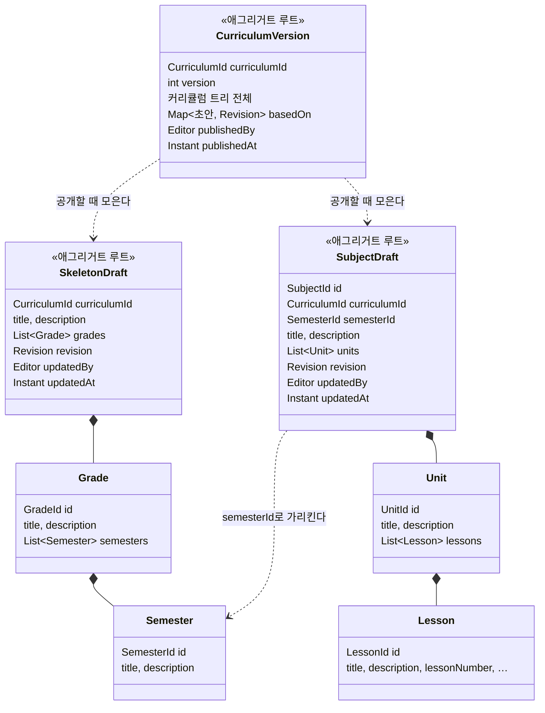
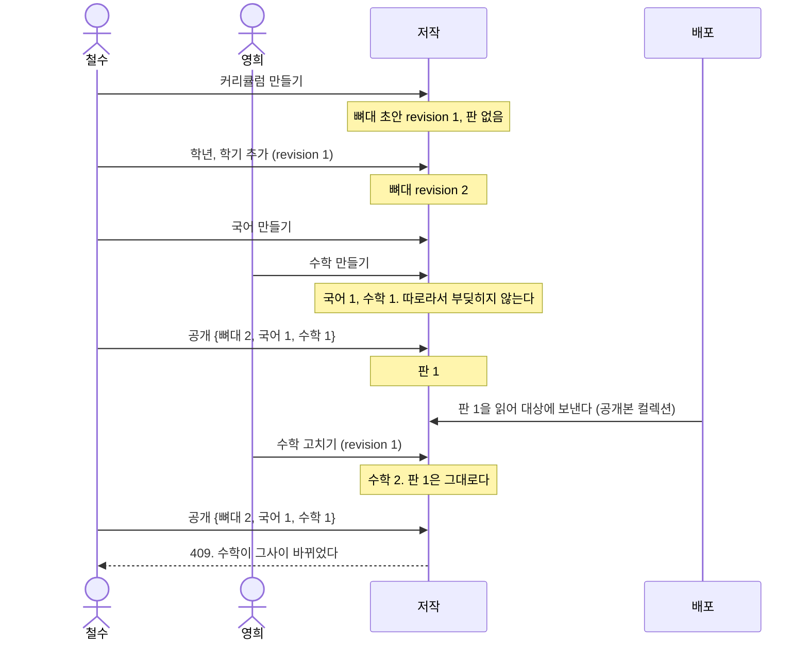

# 저작 도메인 모델

> 저작 컨텍스트 안의 **애그리거트, 불변식, 동시 수정 규칙**을 정한다.
> 왜 초안과 공개본을 나눴는지는 [ADR 0008](../adr/0008-authoring-service.md)에, 용어는 [용어집](glossary.md)에 있다.
> 이 문서는 **앞으로 만들 모델**이다. 코드는 아직 없다.

## 1. 풀려는 문제

| 문제 | 일어나는 일 | 이 모델의 답 |
|---|---|---|
| 고치는 중인 커리큘럼이 배포된다 | 편집하는 문서를 배포가 그대로 읽으면, 반쯤 고친 상태가 대상에 들어간다 | 편집은 초안에만 한다. 배포는 공개한 판만 읽는다 |
| 동시에 고치면 수정이 사라진다(갱신 손실) | 둘이 같은 과목을 열어 두고 고치면, 나중에 저장한 사람이 앞사람의 수정을 말없이 덮어쓴다 | 낙관적 락. 내가 본 뒤로 누가 저장했으면 거절한다 |

## 2. 애그리거트



| 애그리거트 | 하나에 들어 있는 것 | 개수 |
|---|---|---|
| **뼈대 초안 (`SkeletonDraft`)** | 커리큘럼 정보, 학년, 학기 | 커리큘럼마다 하나 |
| **과목 초안 (`SubjectDraft`)** | 과목 하나와 그 아래 단원, 차시. 어느 학기에 속하는지(`semesterId`) | 과목마다 하나 |
| **판 (`CurriculumVersion`)** | 공개한 순간의 커리큘럼 트리 전체. 어떤 초안의 어느 revision으로 만들었는지(`basedOn`) | 공개할 때마다 하나 |

### 왜 뼈대와 과목을 나눴나

낙관적 락은 **애그리거트 하나에 revision 하나**다. 그래서 애그리거트를 어떻게 자르느냐가 "무엇끼리 부딪히는가"를 정한다.

| | 방식 | 국어와 수학을 동시에 고치면 |
|---|---|---|
| A | 커리큘럼 트리 전체가 애그리거트 하나 | 늦게 저장한 사람이 거절된다. 서로 다른 과목인데도 그렇다 |
| **B** | 뼈대 하나 + 과목마다 하나 | 둘 다 저장된다. 같은 과목을 고칠 때만 늦은 사람이 거절된다 |

**B로 정했다.** 실무에서는 한 커리큘럼의 과목을 여러 명이 나눠 고쳤다. A로 가면 거절이 자주 나서 쓸 수 없다. 자세한 근거와 만들면서 겪은 비용은 [ADR 0009](../adr/0009-split-curriculum-draft.md)에 있다.

배포의 청크도 뼈대 하나 + 과목 N개다. 저작의 애그리거트가 같은 선을 따르므로, 과목 하나를 고치면 대상에서도 그 과목 청크만 내용이 바뀐다.

감수하는 것: 공개할 때 여러 애그리거트를 한 시점으로 모아야 한다([5절](#5-공개)).

### 왜 판은 따로 두나

판은 고치지 않는 기록이다. 초안과 한 애그리거트에 두면 "초안을 고칠 때 판도 함께 잠기는" 일이 생긴다. 판에는 revision이 없다. 고치지 않으므로 부딪힐 일이 없다.

## 3. 불변식

| # | 불변식 | 왜 | 누가 지키나 |
|---|---|---|---|
| 1 | 한 번 쓴 판은 고치지 않는다 | 배포가 어느 판을 보냈는지가 나중에 흔들리면 안 된다 | `CurriculumVersion`에 고치는 메서드를 두지 않는다 |
| 2 | 판 번호는 커리큘럼마다 1부터 1씩 커진다. 빠지거나 겹치는 번호가 없다 | "가장 최근 판"이 하나로 정해져야 한다 | 공개가 `직전 판 + 1`로 만든다. 둘이 동시에 공개하면 저장소의 유일 제약(커리큘럼 ID + 판 번호)이 하나를 막는다 |
| 3 | 한 커리큘럼 안에서 ID가 겹치지 않는다 | 대상은 ID로 기존 데이터와 맞춰 합친다. 겹치면 엉뚱한 것을 덮어쓴다 | 같은 애그리거트 안은 그 애그리거트가, 과목끼리는 공개할 때 다시 본다 |
| 4 | 한 번 만든 ID는 바꾸지 않는다 | 대상에서 ID가 바뀌면 "지우고 새로 넣기"가 되어 학습 기록이 끊길 수 있다 | ID를 고치는 메서드를 두지 않는다. 바꾸려면 지우고 새로 만든다 |
| 5 | 바뀐 것이 없으면 공개하지 않는다 | 같은 내용의 판이 쌓이지 않게 한다 | 지금 초안들의 revision이 직전 판의 `basedOn`과 같으면 거절한다 |
| 6 | 과목은 뼈대에 있는 학기에만 속한다 | 대상은 학기가 있어야 과목을 저장할 수 있다 | 과목을 저장할 때 보고, 공개할 때 다시 본다(6절) |

5번은 내용이 아니라 revision으로 비교한다. 누가 저장만 하고 내용을 그대로 두면 revision은 올라가므로 "바뀌었다"로 본다. 트리 전체를 비교하는 것보다 단순하고, 같은 내용의 판이 가끔 하나 더 생기는 정도는 받아들인다.

**ID는 시스템이 만든다.** 사람이 치게 하면 겹치기 쉽고(3번), 오타를 고치고 싶어진다(4번). 대상의 과목 ID는 커리큘럼을 넘어 유일해야 하므로(`subject.subject_id` 유일 제약) 겹치지 않는 값을 쓴다. 만드는 방식은 시스템 설계에서 정한다.

## 4. 동시 수정: 낙관적 락

### 저장할 때

초안을 열 때 내용과 함께 그 애그리거트의 **revision**을 받는다. 저장할 때 그 revision을 함께 보낸다.

```text
1. 편집 화면 열기   GET  과목 초안          → 내용 + revision 5
2. 고치기           (화면 안에서만. 서버는 모른다)
3. 저장             PUT  과목 초안 {내용, revision 5}
     지금 5이면  → 저장하고 revision 6. 화면은 6을 받는다
     지금 6이면  → 409 거절. "철수가 10:05에 먼저 고쳤습니다. 다시 불러오세요"
```

| 규칙 | 이유 |
|---|---|
| revision은 저장할 때마다 1씩 오른다. 새로 만든 초안은 1이다 | "내가 본 것"과 "지금"이 같은지 숫자 하나로 안다 |
| revision이 다르면 거절한다. 덮어쓰지 않는다 | 갱신 손실을 막는다 |
| 거절할 때 누가 언제 먼저 고쳤는지 알려 준다 | 거절된 사람이 그 사람과 이야기할 수 있다 |
| 자동으로 합치지 않는다. 거절된 사람이 다시 읽고 다시 고친다 | 과목 안의 수정을 합치는 규칙은 복잡하고 틀리기 쉽다. 과목 단위로 나눠서 부딪히는 일 자체가 드물다 |
| 과목을 지울 때도 revision을 보낸다 | 누가 방금 고친 과목을 보지 못한 채 지우지 않게 한다 |

**비관적 락(편집 화면을 열면 남이 못 열게 막기)은 쓰지 않는다.** 편집 화면은 오래 열어 두고, 자리를 뜨거나 창을 닫으면 잠금이 남는다. 잠금을 풀어 주는 규칙(시간 제한, 강제 해제)이 더 필요해진다.

### revision과 판 번호

| | revision | 판 번호 (version) |
|---|---|---|
| 어디에 | 뼈대 초안, 과목 초안마다 | 판 |
| 언제 오르나 | 초안을 **저장**할 때마다 | **공개**할 때만 |
| 무엇을 위해 | 낙관적 락 | 배포할 고정된 판을 구분 |

## 5. 공개

공개는 뼈대 초안과 그 커리큘럼의 과목 초안 전부를 모아 새 판을 만든다.

```text
1. 공개 화면 열기   뼈대와 모든 과목의 revision을 받는다
                    예) 뼈대 2, 국어 7, 수학 6, 영어 3
2. 공개             POST 공개 {revision 목록}
     목록이 지금과 하나라도 다르면 → 409 거절. 그사이 누가 고쳤다
     과목이 늘거나 줄었어도       → 409 거절
     직전 판의 basedOn과 같으면   → 거절. 바뀐 것이 없다 (불변식 5)
     검사(6절)에 걸리면           → 422 거절
     통과하면                     → 판 번호 = 직전 판 + 1, basedOn = 이 목록
```

**공개도 낙관적 락을 건다.** 공개 버튼을 누르기 직전에 누가 수학을 저장했다면, 공개하는 사람이 보지 못한 수학이 판에 들어간다. 그래서 공개하는 사람이 본 revision 목록과 지금 목록이 같을 때만 공개한다.

공개는 초안을 바꾸지 않는다. 공개한 뒤에도 초안은 그대로 이어서 고친다.

판의 모양은 지금 원본 문서 모양을 따른다([원본 읽기 4.1](../system/source-read.md#41-원본-문서의-모양)). 배포의 원본 변환기가 그대로 읽어야 하기 때문이다([ADR 0008](../adr/0008-authoring-service.md) 원칙 2).

## 6. 여러 애그리거트에 걸친 규칙

뼈대와 과목이 따로 저장되므로, 학기와 과목 사이의 규칙은 한 애그리거트가 혼자 지킬 수 없다.

| 규칙 | 저장할 때 | 공개할 때 |
|---|---|---|
| **과목이 남아 있는 학기는 지울 수 없다** | 뼈대에서 학기를 지울 때, 그 학기를 가리키는 과목이 있으면 거절한다 | (아래 줄이 같은 것을 본다) |
| **과목은 뼈대에 있는 학기에만 속한다** (불변식 6) | 과목을 저장할 때 그 학기가 뼈대에 있는지 본다 | 모든 과목의 학기가 뼈대에 있는지 다시 본다 |
| **과목끼리 ID가 겹치지 않는다** (불변식 3) | 시스템이 ID를 만들므로 겹치지 않는다 | 다시 본다 |

학기를 지우는 것과 그 학기에 과목을 저장하는 것이 같은 순간에 일어나면, 저장할 때의 검사는 둘 다 통과할 수 있다. 서로 다른 애그리거트라 한 번에 잠그지 않기 때문이다. 그래서 **공개할 때 다시 본다.** 초안에는 잠깐 어긋난 상태가 있을 수 있지만, 판에는 들어가지 않는다. 배포가 읽는 것은 판뿐이다.

학기를 지우면 그 학기의 과목도 함께 지우는 방법은 고르지 않았다. 다른 사람이 고치던 과목이 말없이 사라진다. 과목을 먼저 지우거나 다른 학기로 옮긴 뒤에 학기를 지운다.

## 7. 커리큘럼 하나의 흐름



- 판이 하나도 없는 커리큘럼은 배포에서 보이지 않는다.
- 공개한 뒤에 초안을 고쳐도, 다시 공개하기 전에는 배포가 옛 판을 읽는다.

## 8. 이번에 하지 않는 것

| 하지 않는 것 | 이유 |
|---|---|
| 커리큘럼 자체를 지우기 | 이미 배포된 커리큘럼을 지우면 대상에서 어떻게 할지 정해야 한다. 과목 지우기는 한다(다음 판에서 빠지고, 배포가 대상에서도 뺀다) |
| 옛 판으로 초안 되돌리기 | 판이 남아 있으므로 나중에 더할 수 있다 |
| 로그인 | 지금 화면처럼 이름만 고른다. 그 이름을 `updatedBy`, `publishedBy`로 남긴다 |
| 차시 하나씩 고치는 API | 과목 하나를 통째로 저장한다. 과목 편집 화면 하나로 충분하다 |
| 자동 병합 | 4절 |

## 9. 시스템 설계로 넘기는 것

> 아래는 [저작 시스템 설계](../system/authoring.md)에서 정했다(2026-11-20).

- **Mongo 문서 크기.** 문서 하나는 16MB가 한계다. 시드 문서 하나가 약 10MB이고, 실제 학년은 속성이 더 많다. 초안은 과목마다 나눠서 작지만, 판은 지금 원본 모양(커리큘럼 하나가 문서 하나)을 따라야 한다.
- **배포가 가장 최근 판을 고르는 방법.** 원본 읽기가 판 번호로 골라 읽을지, 가장 최근 판만 담는 컬렉션을 따로 둘지 정한다.
- **공개의 원자성.** 여러 초안을 읽어 판 하나를 쓰는 동안 누가 저장하면 어떻게 되는지. revision 목록 확인과 판 쓰기를 어떻게 묶을지(Mongo 트랜잭션은 레플리카 셋이 필요하다).
- **낙관적 락의 구현.** Mongo의 조건부 갱신(`revision`이 같을 때만 고치기)으로 한다.
- **ID를 만드는 방식.**
