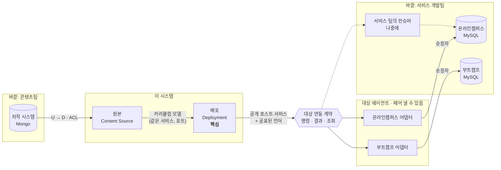

# 컨텍스트 맵

> 도메인 설계 2단계. 이 시스템을 **어떤 경계로 나누고, 경계끼리 어떻게 주고받는지** 정한다.
> 용어는 [용어집](glossary.md)을 따른다.

## 1. 전제: 원래 모델과 지금 상황

### 원래 모델
배포 시스템은 Kafka로 청크를 보내기만 한다. **반영은 각 서비스 시스템이 한다.** 온라인캠퍼스와 부트캠프가 각자 컨슈머를 두고, 자기 DB에 자기 방식으로 쓰고, 결과를 돌려준다. 자기 DB를 아는 것은 자기 팀뿐이기 때문이다.

### 지금 상황
서비스 팀이 컨슈머를 개발할 수 없다고 본다. 그래서 **그 팀들 대신 반영하는 컨슈머를 우리가 만들어 둔다.** 지금의 data-migration-service가 이것이다. 이 시스템을 **대상 에이전트(Target Agent)**라고 부른다. 왜 이 방식을 골랐는지는 [ADR 0002](../adr/0002-target-agent.md)에 있다.

### 그래서 지켜야 할 것
대상 에이전트는 **언제든 떼어 낼 수 있어야 한다.** 서비스 팀이 자기 컨슈머를 만들면 그 대상만 에이전트에서 빼고 넘겨줄 수 있어야 한다. 이 전제에서 세 가지 원칙이 나온다.

1. **배포 시스템은 대상 에이전트가 있다는 사실을 몰라야 한다.** 배포는 "대상에 명령을 보내고 결과를 받는다"만 안다. 결과를 에이전트가 보냈는지 서비스 팀 컨슈머가 보냈는지 구분하지 않는다.
2. **에이전트를 떼어 내도 사라지면 안 되는 것은 에이전트에 두지 않는다.** 대상 목록, 배포 허용 여부, 배포 기록이 여기에 해당한다.
3. **대상과의 약속은 문서로 된 계약 하나뿐이다.** 서비스 팀이 그 계약만 읽고 자기 컨슈머를 만들 수 있어야 한다. 에이전트만 아는 지름길(예: 대상 DB를 직접 읽기)에 기대는 기능은 만들지 않는다.

## 2. 바깥 시스템

| 바깥 시스템 | 주인 | 이 시스템과의 관계 |
|---|---|---|
| 저작 시스템 (저작 DB, Mongo) | 콘텐츠팀 | 읽기만 한다. 문서 모양을 바꿀 권한이 없다. |
| 온라인캠퍼스 (서비스 DB, MySQL) | 온라인캠퍼스 개발팀 | **원래는** 그 팀의 컨슈머가 반영한다. **지금은** 대상 에이전트가 대신 그 DB에 쓴다. |
| 부트캠프 (서비스 DB, MySQL) | 부트캠프 개발팀 | 위와 같다. |

## 3. 컨텍스트

### 배포 (Deployment) — 핵심
| | |
|---|---|
| 하는 일 | 배포를 접수하고, 청크로 나눠 대상에 보내고, 결과를 모아 배포가 끝났는지 판단한다. 재전송도 여기서 한다. **어디로 배포할 수 있는지(대상 목록, 배포 허용)도 여기서 관리한다.** |
| 지키는 규칙 | 커리큘럼 × 대상마다 진행 중인 배포는 하나. 모든 청크가 반영돼야 완료. 실패한 청크만 다시 보낼 수 있다. 배포 허용이 꺼진 대상은 접수하지 않는다. |
| 가진 데이터 | 배포(`transfer_log`), 청크(`transfer_chunks`), 아웃박스(`transfer_outbox`), 대상(지금은 data-migration-service의 `datamigrations` 에 있음 → 옮긴다) |
| 모르는 것 | 원본 문서가 Mongo에 어떤 모양으로 있는지. 대상 DB가 어떤 테이블인지. **누가 대상 쪽 컨슈머를 돌리는지.** |

**왜 핵심인가**: 저작 DB를 읽는 코드나 MySQL에 쓰는 코드는 누가 만들어도 비슷하다. "언제 배포가 끝났다고 말할 수 있는가, 실패하면 무엇을 다시 보내는가"가 이 시스템의 쓸모이고, 업무 규칙이 가장 많이 모이는 곳이다.

**왜 대상 목록이 여기 있나**: 대상은 "배포를 보낼 수 있는 곳"이라는 배포의 개념이다. 에이전트를 떼어 내도 "온라인캠퍼스 PROD로 배포한다"는 사실은 그대로 남는다.

### 원본 (Content Source) — 지원
| | |
|---|---|
| 하는 일 | 원본 저장소를 등록하고 연결을 확인한다. 저작 문서를 읽어 **커리큘럼 모델로 바꿔** 배포 컨텍스트에 넘긴다. |
| 지키는 규칙 | 꺼진 원본에서는 배포를 시작할 수 없다. 비밀번호는 밖으로 내보내지 않는다. |
| 가진 데이터 | 원본 저장소(`sourceconfig`). 저작 DB는 읽기만 한다. |
| 모르는 것 | 배포가 어떻게 진행되는지 |

### 대상 에이전트 (Target Agent) — 대리 구현
| | |
|---|---|
| 하는 일 | **서비스 팀 대신** 청크를 받아 그 서비스의 DB에 반영하고 결과를 돌려준다. 계약이 요구하면 대상에 들어간 커리큘럼을 읽어 준다. |
| 지키는 규칙 | 계약에 적힌 것만 한다. 같은 청크를 두 번 받아도 결과가 같다(멱등). 대상 하나의 실패가 다른 대상에 번지지 않는다. |
| 가진 데이터 | 대상별 DB 접속 정보, 반영한 커리큘럼 캐시(Redis). 서비스 DB는 쓰지만 주인은 아니다. |
| 모르는 것 | 배포 하나가 청크 몇 개인지, 배포가 끝났는지, 배포 허용이 켜져 있는지 |

이건 업무 영역이라기보다 **서비스 팀의 컨슈머를 대신 구현한 것**이다. 그래서 대상마다 따로 떼어 낼 수 있게 대상별 어댑터로 나눈다. 온라인캠퍼스 팀이 자기 컨슈머를 만들면 온라인캠퍼스 어댑터만 끄면 된다.

### 컨텍스트가 아닌 것
- **화면(transfer-console)**: 컨텍스트의 API를 모아 보여 주는 곳이다. 자기 규칙을 갖지 않는다. 화면이 규칙을 지키더라도(예: 진행 중이면 버튼을 막는 것) 그건 편의일 뿐이고, 같은 규칙을 서버가 다시 지킨다.
- **config-service, Kafka, Schema Registry**: 업무와 상관없는 기반 시설이다.

## 4. 컨텍스트 맵

U는 상류(모델을 정하는 쪽), D는 하류(따르는 쪽)다. 점선은 원래 모델(나중에 서비스 팀이 맡을 부분)이다.

| 관계 | 패턴 | 뜻과 이유 |
|---|---|---|
| 저작 시스템 → 원본 | **부패 방지 계층(ACL)** | 저작 문서는 우리가 바꿀 수 없다. 원본 컨텍스트가 문서를 읽어 커리큘럼 모델로 바꾼다. 문서 필드 이름이 바뀌어도 고칠 곳은 변환기 하나다. 지금은 `CurriculumSourceConverter`가 이 역할을 한다. |
| 원본 → 배포 | **같은 서비스 안의 포트** | 둘은 같은 프로세스에 있지만 모델이 다르다. 배포는 "원본 저장소 ID와 커리큘럼 ID를 주면 커리큘럼을 준다"는 포트만 안다. |
| 배포 → 대상 | **공개 호스트 서비스(OHS) + 공표된 언어(PL)** | 배포가 모든 대상에 같은 계약을 연다. 대상이 누구든(에이전트든 서비스 팀이든) 이 계약 하나만 구현하면 된다. 계약은 Avro 스키마로 고정하고 레지스트리로 호환성을 검사한다([ADR 0001](../adr/0001-message-contract-distribution.md)). 처음 설계(고객-공급자)와 달리 **배포가 대상마다 맞춰 주지 않는다.** 대상이 늘 때 배포 코드를 고치지 않기 위해서다. |
| 대상 에이전트 → 서비스 DB | **순응자(Conformist)** | 서비스 DB 스키마는 그 팀이 정하고 에이전트는 따른다. 순응하는 범위가 에이전트 안에 갇혀 있어서 배포 컨텍스트는 영향을 받지 않는다. |

## 5. 대상 연동 계약

에이전트를 떼어 낼 수 있으려면 **서비스 팀이 무엇을 만들면 되는지**가 문서 하나로 정리돼 있어야 한다. 계약은 세 가지다. 메시지 이름과 필드는 [이벤트와 메시지](events.md) 단계에서 정한다.

| | 계약 | 대상이 해야 할 일 | 왜 필요한가 |
|---|---|---|---|
| 1 | **반영 명령을 받는다** | 자기 대상 앞으로 온 청크 명령을 받아 반영한다. 같은 명령을 두 번 받아도 결과가 같아야 한다. | 배포의 본래 일 |
| 2 | **반영 결과를 돌려준다** | 청크마다 성공·실패와 실패 사유를 돌려준다. 성공이면 **무엇을 반영했는지(과목 ID, 단원·차시 수)**도 담는다. | 배포가 끝났는지 판단하고, 대상 DB를 읽지 않고도 검증할 수 있게 |
| 3 | **반영한 내용을 조회해 준다** (선택) | 커리큘럼 ID로 지금 들어 있는 트리를 돌려준다. | 배포 뒤에 누가 대상 데이터를 고쳤는지까지 보려면 필요하다 |

### 이 계약에서 바뀌는 결정

**검증**
- 처음 생각은 "화면이 대상 DB를 읽어 원본과 비교한다"였다. 이건 에이전트가 대상 DB에 접근할 수 있을 때만 된다. 서비스 팀 컨슈머로 넘어가면 우리는 그 DB에 접근할 수 없다.
- **정한 것**: 기본 검증은 **계약 2의 결과에 담긴 반영 내용**으로 한다. 배포 컨텍스트가 청크 결과를 모아 "대상에 무엇이 들어갔는가"를 알고, 원본과 비교한다. 대상이 계약 3을 제공하면 그걸로 실제 데이터까지 확인한다.
- 그래서 검증은 배포 컨텍스트의 일이 된다. 지금 화면에 있는 비교(`compareTrees`)는 나중에 배포 컨텍스트로 옮긴다.

**연결 테스트**
- 지금 대상 화면의 연결 테스트는 에이전트가 대상 DB에 접속해 보는 것이다. 서비스 팀 컨슈머로 넘어가면 우리가 할 수 없다.
- **정한 것**: 대상의 상태는 **결과가 제때 돌아오는가**로 본다(마지막 결과 시각, 응답하지 않은 청크 수). DB 연결 테스트는 에이전트가 맡은 대상에서만 보여 주는 보조 정보로 둔다.

**토픽 나누기 (선택)**
- 지금은 토픽 하나에 모든 대상의 명령이 섞이고, 에이전트가 `dataMigrationId`로 대상을 찾아 어댑터를 고른다(`DataPersistHandler`, `@ServiceTypeSelector`).
- **이대로도 떼어 낼 수 있다.** 서비스 팀 컨슈머가 자기 컨슈머 그룹으로 토픽을 전부 읽고, 자기 대상 앞으로 온 명령만 처리하면 된다. 배포 시스템은 고칠 것이 없다.
- 대상 시스템마다 토픽을 나누면 더 깔끔하다. 남의 명령을 읽지 않고, 대상별로 부하와 지연을 따로 볼 수 있다. 하지만 떼어 내는 데 꼭 필요하지는 않다.
- **방향**: 필수 작업이 아니라 선택 사항으로 둔다. 나눌지와 토픽 이름·파티션 키는 시스템 설계 단계에서 정한다. 토픽은 운영 중에 바꾸기 번거로우니, 나눈다면 일찍 정하는 편이 싸다.

### 떼어 낼 때 배포 시스템은 바뀌는가
두 서비스는 이미 다른 프로세스이고 Kafka 메시지로만 이야기한다. 그래서 **에이전트를 대상별로 쪼개거나 서비스 팀 컨슈머로 넘기는 일 자체는 배포 시스템을 건드리지 않고 할 수 있다.** 지금 구조도 거의 그렇다.

배포 시스템이 바뀌는 것은 떼어 내기 때문이 아니라 **지금 잘못된 자리에 있는 것을 옮기기 때문**이다.

| 변경 | 배포 시스템 | 이유 |
|---|---|---|
| 에이전트를 대상별로 쪼개기, 서비스 팀 컨슈머로 넘기기 | 안 바뀐다 | 메시지 계약만 지키면 된다 |
| 토픽 나누기 | 토픽 이름 설정만 | 선택 사항 |
| **대상 목록·배포 허용 옮기기** | **한 번 바뀐다** | 에이전트에 남겨 두면, 쪼갠 뒤에 반영은 안 하고 목록만 가진 중앙 서비스가 남는다. 서비스 팀에 나눠 주면 우리 운영자의 기능(배포 허용)의 주인이 서비스 팀이 된다. 둘 다 어색하다. |
| 결과에 반영 내용 담기 | 바뀐다 | 검증을 결과 메시지로 할 때만. 조회 계약(3)으로만 검증하면 바뀌지 않는다 |

즉 떼어 내기 전에 해야 할 배포 시스템 쪽 일은 **대상 목록을 옮기는 것 하나**다. 이걸 마치면 그 뒤로는 배포 시스템을 건드리지 않는다.

## 6. 서비스와 이름

| 컨텍스트 | 서비스 (지금) | 서비스 (바꿀 이름) | 이유 |
|---|---|---|---|
| 배포 + 원본 | `transfer-service` | **`deployment-service`** | 핵심 컨텍스트 이름을 그대로 쓴다. 원본 읽기는 배포를 접수할 때만 쓰므로 따로 띄우면 호출 하나가 늘 뿐 얻는 게 없다. |
| 대상 에이전트 | `data-migration-service` | **`target-agent`** | 이 서비스는 대상의 주인이 아니라 **대상을 대신해 일하는 쪽**이다. 이름에서 그게 드러나야 떼어 낼 수 있는 부분이라는 게 보인다. |

`target-agent` 로 정하기 전에 본 이름들:
| 후보 | 고르지 않은 이유 |
|---|---|
| `target-service` | 대상의 주인처럼 들린다. 대상 목록은 배포 컨텍스트가 갖기로 했다. |
| `apply-service` | 하는 일 하나만 가리키고, 대리 구현이라는 점이 드러나지 않는다. |
| `data-migration-service` (유지) | [용어집](glossary.md)에서 "마이그레이션"은 쓰지 않기로 했다. |

이름을 실제로 바꾸는 일(모듈, 패키지, 설정, k8s 매니페스트, Kafka 토픽)은 코드 정리 단계에서 한다.

## 7. 지금 코드와 어긋나는 점

| 어긋남 | 어디 | 고칠 방향 |
|---|---|---|
| 대상 목록과 배포 허용이 에이전트 쪽에 있다 | data-migration-service의 `datamigrations`, `DataMigrationInfoRepository` | 배포 컨텍스트로 옮긴다. 에이전트는 자기가 맡은 대상의 접속 정보만 갖는다 |
| 모든 대상의 명령이 토픽 하나로 간다 (선택) | `data-migration-request` 토픽, `DataPersistHandler` | 떼어 내는 데 필수는 아니다. 나눌지는 시스템 설계 단계에서 정한다 |
| 반영 결과에 "무엇을 반영했는지"가 없다 | `data_migration_response.avsc` | 결과에 반영 내용을 담는다 (계약 2) |
| 원본 변환기가 배포의 애플리케이션 계층에 섞여 있다 | `transfer-application-service`의 `helper/transfer/curriculum/CurriculumSourceConverter` | 원본 컨텍스트 패키지로 옮기고, 배포는 포트로만 부른다 |
| 청크 나누기 규칙(뼈대 + 과목)이 변환기 안에 있다 | 같은 곳 | 어떻게 나눌지는 배포 규칙이다. 원본은 커리큘럼 트리만 주고 배포가 나눈다 |
| 대상 스키마 엔티티가 `onlinecampus` 패키지에만 있고, 부트캠프 반영 코드는 아직 없다 | `data-migration-dataaccess`, `BootCampDataPersistHelper` | 대상마다 어댑터를 따로 두고 부트캠프 어댑터를 만든다 (ROADMAP Phase 1 "Bootcamp 저장 실제 구현") |
| 메시지에 `sagaId`가 있지만 사가가 없다 | `data_migration_request.avsc` | [이벤트](events.md) 단계에서 정한다 |
| 화면의 대상 데이터 확인이 대상 DB 조회 API에 기댄다 | 1단계 화면, `docs/console-plan.md` 7번 화면 | 계약 2의 반영 결과로 비교하는 쪽으로 바꾼다. 조회 API(계약 3)는 있으면 쓴다 |

## 8. 다음 단계
- [모델](model.md): 배포 컨텍스트 안의 애그리거트, 불변식, 상태 기계 (대상도 여기서 모델링한다)
- [이벤트와 메시지](events.md): 대상 연동 계약의 명령과 결과의 이름과 내용
