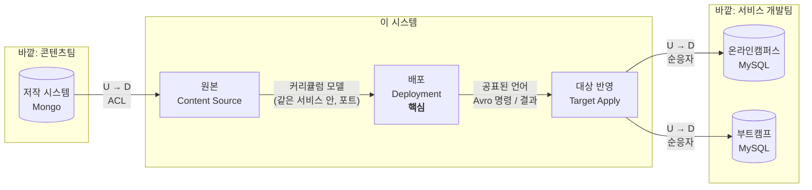

# 컨텍스트 맵

> 도메인 설계 2단계. 이 시스템을 **어떤 경계로 나누고, 경계끼리 어떻게 주고받는지** 정한다.
> 용어는 [용어집](glossary.md)을 따른다.

## 1. 먼저 세상 전체를 본다

이 시스템 바깥에는 이미 주인이 있는 시스템이 셋 있다. 이 시스템은 그 사이에서 **콘텐츠를 옮겨 주는 역할**만 맡는다.

| 바깥 시스템 | 주인 | 이 시스템과의 관계 |
|---|---|---|
| 저작 시스템 (저작 DB, Mongo) | 콘텐츠팀 | 읽기만 한다. 문서 모양을 바꿀 권한이 없다. |
| 온라인캠퍼스 (서비스 DB, MySQL) | 온라인캠퍼스 개발팀 | 그 DB에 직접 써 넣는다. 스키마는 그 팀이 정한다. |
| 부트캠프 (서비스 DB, MySQL) | 부트캠프 개발팀 | 위와 같다. |

이 표에서 경계를 나누는 기준이 두 가지 나온다.
- **바꿀 수 없는 모델을 내 모델로 옮기는 곳**이 따로 있어야 한다. 그래야 저작 문서나 서비스 스키마가 바뀌어도 배포 규칙이 흔들리지 않는다.
- **대상마다 다른 지식**(어떤 DB, 어떤 테이블, 어떤 순서로 써야 하는가)은 배포 규칙과 섞이면 안 된다. 대상이 하나 늘 때마다 배포 코드를 고치게 된다.

## 2. 컨텍스트

이 시스템 안을 세 컨텍스트로 나눈다.

### 배포 (Deployment) — 핵심
| | |
|---|---|
| 하는 일 | 배포를 접수하고, 청크로 나눠 보내고, 결과를 모아 배포가 끝났는지 판단한다. 재전송도 여기서 한다. |
| 지키는 규칙 | 커리큘럼 × 대상마다 진행 중인 배포는 하나. 모든 청크가 반영돼야 완료. 실패한 청크만 다시 보낼 수 있다. |
| 가진 데이터 | 배포(`transfer_log`), 청크(`transfer_chunks`), 아웃박스(`transfer_outbox`) |
| 모르는 것 | 원본 문서가 Mongo에 어떤 모양으로 있는지, 대상 DB가 어떤 테이블인지 |

**왜 핵심인가**: 다른 회사가 이 시스템을 만들어도 저작 DB를 읽는 코드나 MySQL에 쓰는 코드는 비슷하다. "언제 배포가 끝났다고 말할 수 있는가, 실패하면 무엇을 다시 보내는가"가 이 시스템의 쓸모이고, 업무 규칙이 가장 많이 모이는 곳이다.

### 원본 (Content Source) — 지원
| | |
|---|---|
| 하는 일 | 원본 저장소를 등록하고 연결을 확인한다. 저작 문서를 읽어 **커리큘럼 모델로 바꿔** 배포 컨텍스트에 넘긴다. |
| 지키는 규칙 | 꺼진 원본에서는 배포를 시작할 수 없다. 비밀번호는 밖으로 내보내지 않는다. |
| 가진 데이터 | 원본 저장소(`sourceconfig`). 저작 DB는 읽기만 한다. |
| 모르는 것 | 배포가 어떻게 진행되는지 |

### 대상 반영 (Target Apply) — 지원
| | |
|---|---|
| 하는 일 | 대상 목록과 배포 허용 여부를 관리한다. 청크를 받아 해당 대상 DB에 반영하고 결과를 돌려준다. 대상에 들어간 커리큘럼을 읽어 준다(검증용). |
| 지키는 규칙 | 같은 청크를 두 번 받아도 결과가 같다(멱등). 대상 하나의 실패가 다른 대상에 번지지 않는다. |
| 가진 데이터 | 대상(`datamigrations`), 반영한 커리큘럼 캐시(Redis). 서비스 DB는 쓰지만 주인은 아니다. |
| 모르는 것 | 배포 하나가 청크 몇 개인지, 배포가 끝났는지 |

### 컨텍스트가 아닌 것
- **화면(transfer-console)**: 세 컨텍스트의 API를 모아 보여 주는 곳이다. 자기 규칙을 갖지 않는다. 화면이 규칙을 가지면(예: 진행 중이면 버튼을 막는 것) 그건 편의일 뿐이고, 같은 규칙을 서버가 다시 지킨다.
- **config-service, Kafka, Schema Registry**: 업무와 상관없는 기반 시설이다.

## 3. 컨텍스트 맵

U는 상류(모델을 정하는 쪽), D는 하류(따르는 쪽)다.

| 관계 | 패턴 | 뜻과 이유 |
|---|---|---|
| 저작 시스템 → 원본 | **부패 방지 계층(ACL)** | 저작 문서는 우리가 바꿀 수 없다. 원본 컨텍스트가 문서를 읽어 커리큘럼 모델로 바꾼다. 문서 필드 이름이 바뀌어도 고칠 곳은 변환기 하나다. 지금 코드에서는 `CurriculumSourceConverter`가 이 역할을 한다. |
| 원본 → 배포 | **같은 서비스 안의 포트** | 둘은 같은 프로세스에 있지만 모델이 다르다. 배포는 "원본 저장소 ID와 커리큘럼 ID를 주면 커리큘럼을 준다"는 포트만 안다. 서비스를 나눌 만큼 따로 바뀌지는 않아서 한 서비스에 둔다. |
| 배포 → 대상 반영 | **공표된 언어 + 고객-공급자** | 둘은 Kafka 메시지로만 이야기한다. 계약은 Avro 스키마로 고정하고 레지스트리로 호환성을 검사한다([ADR 0001](../adr/0001-message-contract-distribution.md)). 배포가 "무엇을 반영하라"를 정하는 고객이고, 대상 반영은 "멱등하게 반영하고 결과를 돌려준다"를 약속하는 공급자다. |
| 대상 반영 → 서비스 시스템 | **순응자(Conformist)** | 서비스 DB 스키마는 그 팀이 정하고 우리는 따른다. 대상마다 어댑터를 둔다(`OnlineCampusDataPersistHelper`, `BootCampDataPersistHelper`. 부트캠프 쪽은 아직 빈 껍데기다). 순응하는 범위가 대상 반영 안에 갇혀 있어서, 서비스 스키마가 바뀌어도 배포 컨텍스트는 그대로다. |

### 대상 정보는 누가 갖는가
배포를 접수할 때 "그 대상이 배포를 허용하는가"를 알아야 한다. 하지만 대상의 주인은 대상 반영 컨텍스트다.
- **정한 것**: 배포 컨텍스트는 대상 ID만 들고 있다. 접수할 때 대상 반영 컨텍스트에 물어본다.
- **고르지 않은 것**: 배포 쪽에 대상 테이블을 복사해 두는 방식. 응답이 빠르지만 허용을 끈 직후에도 배포가 접수될 수 있다. 대상 수가 몇 개뿐이고 배포가 하루 수십 건이라 매번 물어도 부담이 없다.
- 나중에 대상 반영이 죽어 있을 때도 접수만은 받아야 한다면, 대상 변경을 이벤트로 받아 캐시하는 방식으로 바꾼다.

### 검증은 누가 하는가
검증은 원본 트리와 대상 트리가 둘 다 있어야 한다. 두 트리의 주인이 다르다(원본, 대상 반영).
- **정한 것**: 지금은 화면이 두 API를 불러 비교한다. 비교는 읽기만 하고 아무것도 바꾸지 않으며, 결과를 저장하지도 않는다.
- **나중에 바꿀 때**: 배포가 끝나면 자동으로 검증하고 그 결과를 배포 상태에 반영해야 한다면(예: "반영은 됐지만 원본과 다름"), 검증은 배포 컨텍스트로 옮긴다. 그때는 업무 규칙이 되기 때문이다.

## 4. 서비스와 이름

컨텍스트와 서비스(배포 단위)는 같지 않다. 원본과 배포는 한 서비스에 두고, 대상 반영은 따로 둔다.

| 컨텍스트 | 서비스 (지금) | 서비스 (바꿀 이름) | 한 서비스에 둔 이유 / 나눈 이유 |
|---|---|---|---|
| 배포 + 원본 | `transfer-service` | **`deployment-service`** | 원본 읽기는 배포를 접수할 때만 쓴다. 따로 띄우면 호출 하나가 늘 뿐 얻는 게 없다. |
| 대상 반영 | `data-migration-service` | **`target-service`** | 대상 DB 접속 정보를 이 서비스만 갖는다. 대상이 늘거나 죽어도 배포 접수는 영향을 받지 않는다. 대상 DB에 쓰는 부하를 따로 늘리고 줄일 수 있다. |

**이름을 이렇게 고른 이유**
- `deployment-service`: 핵심 컨텍스트 이름을 그대로 쓴다.
- `target-service`: 이 서비스는 대상의 주인이고, 대상에 관한 일(목록, 허용, 반영, 읽기)을 모두 한다. `apply-service`는 하는 일 하나만 가리켜서 좁다. `migration`은 [용어집](glossary.md)에서 쓰지 않기로 했다.

이름을 실제로 바꾸는 일(모듈, 패키지, 설정, k8s 매니페스트, Kafka 토픽)은 코드 정리 단계에서 한다. 이 문서는 이름만 정한다.

## 5. 지금 코드와 어긋나는 점

경계를 정하고 나니 지금 코드에서 경계를 넘는 곳이 보인다. 코드 정리 단계에서 고칠 목록이다.

| 어긋남 | 어디 | 고칠 방향 |
|---|---|---|
| 원본 변환기가 배포의 애플리케이션 계층에 섞여 있다 | `transfer-application-service`의 `helper/transfer/curriculum/CurriculumSourceConverter` | 원본 컨텍스트 패키지로 옮기고, 배포는 포트로만 부른다 |
| 청크 나누기 규칙(뼈대 + 과목)이 변환기 안에 있다 | 같은 곳 | 청크를 어떻게 나누는지는 배포 규칙이다. 원본은 커리큘럼 트리만 주고, 배포가 나눈다 |
| 대상 스키마 엔티티(`CurriculumEntity` 등)가 `onlinecampus` 패키지에만 있고, 부트캠프 쪽 반영 코드는 아직 없다 | `data-migration-dataaccess`, `BootCampDataPersistHelper` | 대상마다 어댑터 패키지를 따로 두고 부트캠프 어댑터를 만든다 (ROADMAP Phase 1 "Bootcamp 저장 실제 구현") |
| 메시지에 `sagaId`가 이미 있지만 사가가 없다 | `data_migration_request.avsc` | 사가 전까지는 빼거나, 상관관계 ID로 이름을 바꾼다 ([이벤트](events.md) 단계에서 정함) |
| 화면이 대상 이름을 하드코딩했었다 | (1단계 화면에서 고침) | 대상 목록 API를 대상 반영 컨텍스트가 제공한다 |

## 6. 다음 단계
- [모델](model.md): 배포 컨텍스트 안의 애그리거트, 불변식, 상태 기계
- [이벤트와 메시지](events.md): 컨텍스트 사이에 오가는 명령과 결과의 이름과 내용
