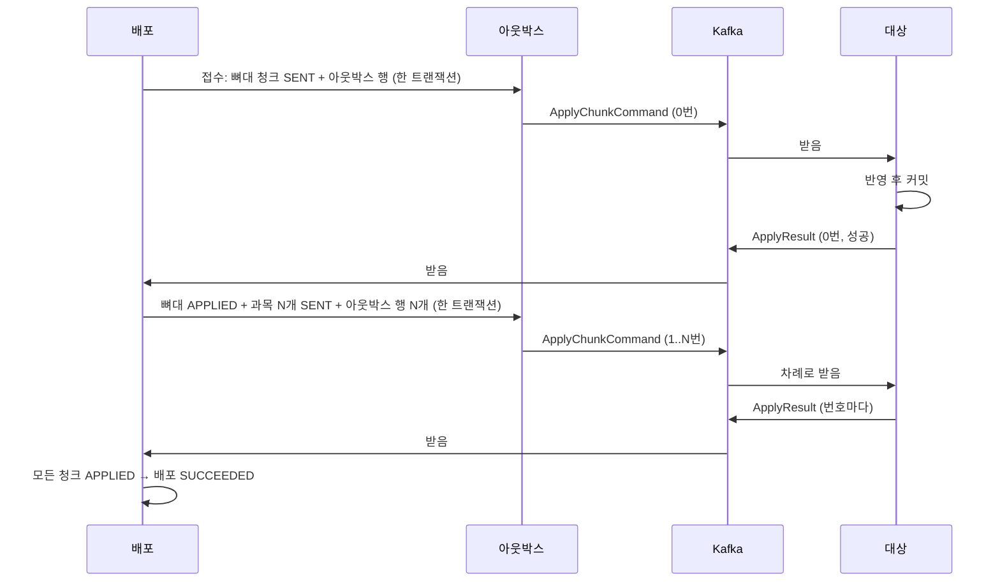

# 이벤트와 메시지

> 도메인 설계 4단계. [컨텍스트 맵](context-map.md#5-대상-연동-계약)의 **대상 연동 계약**을 메시지 수준으로 정한다.
> 이 문서만 읽고 서비스 팀이 자기 컨슈머를 만들 수 있어야 한다.
> 코드는 아직 이 모양이 아니다.

## 1. 무엇이 경계를 넘는가

경계를 넘는 메시지는 둘뿐이다.

| 메시지 | 보내는 쪽 → 받는 쪽 | 뜻 | Kafka 키 |
|---|---|---|---|
| **`ApplyChunkCommand`** | 배포 → 대상 | 이 청크를 반영해 달라 | 대상 + 커리큘럼 ID ([왜](model.md#7-메시지-순서)) |
| **`ApplyResult`** | 대상 → 배포 | 이 청크를 이번 시도에서 반영했다 / 못 했다 | 배포 ID |



### 왜 배포 이벤트를 밖으로 내보내지 않나

`DeploymentSucceeded` 같은 이벤트는 만들지 않는다. **지금 구독할 곳이 없기** 때문이다. 화면은 상태를 조회한다.

"뼈대가 반영되면 과목을 보낸다"도 이벤트로 잇지 않는다. `Deployment.recordResult()`가 **이제 보낼 청크 목록을 돌려주고**, 같은 트랜잭션에서 아웃박스 행을 만든다. 이벤트로 나누면 흐름만 흩어지고 얻는 것이 없다.

알림이나 통계처럼 구독할 곳이 생기면 그때 아웃박스의 새 메시지 종류로 더한다. [아웃박스를 별도 표로 둔 이유](../adr/0004-transactional-outbox.md)가 이것이다.

## 2. ApplyChunkCommand

| 필드 | 타입 | 뜻 |
|---|---|---|
| `deploymentId` | uuid 문자열 | 어느 배포인가. 대상은 해석하지 않고 결과에 그대로 돌려준다 |
| `chunkNo` | int | 청크 순번. 0번이 뼈대다. 결과에 그대로 돌려준다 |
| `attempt` | int | 몇 번째 시도인가. 1부터다. 결과에 그대로 돌려준다 |
| `targetSystem` | string | `ONLINE_CAMPUS`, `BOOTCAMP` |
| `environment` | string | `DEV`, `PROD` |
| `curriculumId` | string | 커리큘럼 ID |
| `content` | `SkeletonContent` 또는 `SubjectContent` | 반영할 내용 ([4절](#4-내용은-avro-타입으로-싣는다)) |
| `createdAt` | timestamp-millis | 명령을 만든 시각. 지연을 볼 때 쓴다 |

### 고른 것과 빼낸 것

| 결정 | 이유 |
|---|---|
| 대상을 `targetSystem` + `environment`로 싣는다 (전에는 `dataMigrationId`) | 숫자 ID는 우리 표의 행 번호다. 서비스 팀은 그 표가 없으므로 어느 명령이 자기 것인지 알 수 없다 |
| 두 값을 enum이 아닌 문자열로 둔다 | enum이면 새 서비스가 생길 때 스키마를 고쳐야 하고, 옛 소비자가 모르는 값을 읽다 실패할 수 있다. 자기 값이 아니면 건너뛰기만 하면 된다 |
| `sagaId`를 뺀다 | 사가를 미뤘고([ADR 0003](../adr/0003-defer-saga.md)), 지금 코드에서도 무작위 값일 뿐이다 |
| 청크 총 개수를 싣지 않는다 | 대상은 "배포 하나가 청크 몇 개인지" 몰라야 한다. 끝났는지 판단하는 일은 배포의 것이다 |
| `requestedBy`를 싣지 않는다 | 반영에 필요 없다 |

## 3. ApplyResult

| 필드 | 타입 | 뜻 |
|---|---|---|
| `deploymentId`, `chunkNo`, `attempt` | 명령과 같음 | 명령에서 그대로 복사한다 |
| `outcome` | `Applied` 또는 `Rejected` | 반영 결과 |
| `occurredAt` | timestamp-millis | 대상이 처리를 마친 시각 |

성공과 실패를 메시지 둘로 나누지 않고 한 메시지의 `outcome`으로 둔다. 한 키의 메시지 종류가 하나여야 스키마 관리와 소비가 단순하다. 지금처럼 상태 enum(`PENDING`, `SENT`...)을 싣지 않는다. **대상이 알려 주는 것은 사실이고, 상태를 정하는 것은 배포다.**

| `outcome` | 필드 | 뜻 |
|---|---|---|
| `Applied` | `content`: `AppliedSkeleton` 또는 `AppliedSubject` | 커밋까지 끝났다 |
| `Rejected` | `message`: string | 재시도해도 안 되거나 재시도를 다 썼다. 운영자가 읽을 문장이다 |

| 반영 내용 | 필드 | 쓰는 곳 |
|---|---|---|
| `AppliedSkeleton` | `gradeCount`, `semesterCount`, `removedSubjectIds`([6절](#6-원본에서-지운-과목은-대상에서도-뺀다)) | 검증, 상세 화면 |
| `AppliedSubject` | `subjectId`, `title`, `unitCount`, `lessonCount` | 검증 |

**대상이 실제로 저장한 값**을 담는다. 명령의 내용을 그대로 되돌려 주면 검증이 아니라 메아리다. 제목을 넣은 이유는 [용어집](glossary.md#검증-verification)이 "같은 ID인데 제목이 다르면 변경됨"으로 정했기 때문이다.

실패 사유를 코드로 나누지 않고 문장 하나로 둔다. 배포는 실패 종류에 따라 다르게 움직이지 않는다. 자동 재시도가 없고 운영자가 읽고 판단한다. 나중에 코드가 필요하면 기본값이 있는 필드로 더하면 된다.

## 4. 내용은 Avro 타입으로 싣는다

### 지금의 문제
지금은 내용이 `jsonData: bytes`다. 코드를 따라가 보면 문제가 셋이다.

| 문제 | 근거 | 일어나는 일 |
|---|---|---|
| **원본 문서 모양이 대상까지 그대로 간다** | `CurriculumSourceConverter`: `subjectNode.set("subject", subject)` | 저작 문서의 필드 이름이 바뀌면 대상이 깨진다. [컨텍스트 맵](context-map.md#4-컨텍스트-맵)의 ACL이 내용에서는 지켜지지 않는다 |
| **레지스트리가 내용을 검사하지 못한다** | Avro 스키마에서 내용은 그냥 `bytes`다 | 봉투만 호환성을 검사한다. 정작 깨지기 쉬운 내용은 실행 중에야 드러난다 |
| **계약이 문서로 존재하지 않는다** | 에이전트가 `Document.getString("id")`로 꺼낸다. 뼈대인지는 `curriculum` 키가 있는지로 짐작한다(`CurriculumRepositoryImpl`) | 서비스 팀이 무엇을 읽어야 하는지 알려면 우리 코드를 봐야 한다. 컨텍스트 맵의 원칙 3에 어긋난다 |

### 선택지

| | 방식 | 장점 | 단점 |
|---|---|---|---|
| A | 원본 JSON을 `bytes`로 그대로 (지금) | 바꿀 것이 없다. 원본에 필드가 늘면 자동으로 실린다 | 위 문제 셋이 그대로다 |
| B | 우리가 정한 JSON을 `bytes`로 싣고 문서·JSON Schema로 설명 | 원본과 분리된다. 스키마 변경 부담이 적다 | 검사를 따로 만들어야 하고, 문서와 실제가 어긋날 수 있다 |
| **C** | **Avro 타입으로 정의** | 레지스트리와 `test-compatibility`가 내용까지 검사한다. `.avsc`가 곧 서비스 팀이 읽을 계약이다. 대상이 쓰는 필드만 실린다. 뼈대인지는 타입으로 구별한다 | 필드를 더할 때마다 계약을 고쳐야 한다. 변환 코드가 는다 |

**C로 정했다.** 트리의 필드 수가 많지 않아 스키마가 작고, ACL과 공표된 언어라는 [앞의 결정](context-map.md#4-컨텍스트-맵)이 내용까지 실제로 지켜진다. 필드를 더할 때 계약을 고쳐야 하는 것은 단점이면서 곧 이 방식의 목적이다. 에이전트를 떼어 내려면([ADR 0002](../adr/0002-target-agent.md)) 서비스 팀이 우리 코드를 읽지 않고 계약만으로 컨슈머를 만들 수 있어야 한다는 점도 이 결정의 근거다.

내용은 이렇게 바뀌어 간다. 저작 문서의 모양을 아는 곳은 첫 단계 하나뿐이다.

```text
저작 문서 → (원본 컨텍스트의 ACL) → 커리큘럼 모델 → (배포가 나눔) → 청크 내용 → (messaging 모듈) → Avro
```

**감수하는 것**: 원본에 필드가 늘어도 자동으로 실리지 않는다. 지금 대상이 읽지 않는 원본 필드는 더 이상 나가지 않으므로, 나중에 쓰려면 계약을 고치고 재배포해야 한다.

**B로 바꾸려면**: `content`를 `bytes`로 바꾸고 JSON Schema를 계약에 더한다. 필드가 자주 바뀌어 스키마 변경이 부담될 때 고려한다. 호환성 검사는 CI에 따로 만들어야 한다.

필드는 지금 에이전트가 실제로 읽는 것(`OnlineCampusDataAccessMapper`)을 기준으로 잡았다.

```text
SkeletonContent
  title, description
  grades[]: id, title, description
    semesters[]: id, title, description, subjectIds[]     ← subjectIds 는 6절

SubjectContent
  gradeId, semesterId
  subject: id, title, description
    units[]: id, title, description
      lessons[]: id, title, description, lessonNumber, learningLevel
```

## 5. 대상이 지켜야 할 규칙

서비스 팀 컨슈머든 대상 에이전트든 같다.

| # | 규칙 | 지키지 않으면 |
|---|---|---|
| 1 | 자기 `targetSystem` + `environment`가 아닌 명령은 결과 없이 건너뛴다. [토픽이 대상별](../system/architecture.md#4-kafka-토픽)이라 평소에는 일어나지 않고, 설정 실수를 막는 안전장치다 | 다른 대상의 청크를 반영하거나, 남의 청크에 결과를 보낸다 |
| 2 | 같은 키의 명령은 받은 순서대로 하나씩 처리한다 | [옛 명령이 새 배포를 덮어쓴다](model.md#7-메시지-순서) |
| 3 | 같은 명령을 두 번 처리해도 결과가 같아야 한다 | 재전송과 중복 전달이 데이터를 망가뜨린다 |
| 4 | 청크 하나의 반영은 전부 되거나 전부 안 된다 | `Applied`를 믿을 수 없다 |
| 5 | 잠깐의 오류(DB 연결 끊김 등)는 **그 자리에서** 재시도하고, 끝내 안 되면 `Rejected`를 보낸다 | 다음 명령으로 넘어가면 순서가 깨진다 |
| 6 | 반영을 커밋한 **뒤에** 결과를 보내고, 그 뒤에 오프셋을 커밋한다 | 반영하지 않은 것을 `Applied`로 알리거나 결과가 사라진다 |
| 7 | `deploymentId`, `chunkNo`, `attempt`를 그대로 돌려준다 | 배포가 결과를 청크에 연결할 수 없다 |
| 8 | 뼈대를 반영할 때 학기의 `subjectIds`에 없는 과목을 서비스에서 빼고, 뺀 ID를 결과로 돌려준다 | 지운 과목이 서비스에 계속 보인다 |

**대상 쪽에는 아웃박스가 필요 없다.** 규칙 6대로 하면 결과를 보내기 전에 죽어도 오프셋이 커밋되지 않아 명령을 다시 받는다. 다시 반영해도 규칙 3으로 안전하고, 결과가 그때 나간다. 중복 결과는 배포가 [결과 처리 표](model.md#시도attempt와-결과-처리)대로 걸러 낸다. 그래서 서비스 팀에 요구할 것이 줄어든다.

### 반영 내용 조회 (계약 3, 선택)

제공하는 대상은 커리큘럼 ID를 받아 지금 들어 있는 트리를 돌려준다. 응답은 `SkeletonContent`와 `SubjectContent`를 합친 모양이다. 없어도 배포와 기본 검증은 동작한다. 경로와 인증은 시스템 설계 단계에서 정한다.

### 일이 잘못됐을 때

| 일 | 어디서 드러나나 | 복구 |
|---|---|---|
| 대상이 명령을 해석하지 못한다 | 명령이 DLT로 가고, 기한이 지나 `NO_REPLY` | 원인을 고치고 재전송 |
| 대상이 죽어 있다 | Kafka에 쌓이고, 기한이 지나 `NO_REPLY` | 살아나면 밀린 명령을 차례로 처리한다. 늦은 성공은 `APPLIED`가 된다 |
| 결과가 사라졌다 | 기한이 지나 `NO_REPLY` | 재전송. 멱등하므로 안전하다 |
| 모르는 `deploymentId`나 `chunkNo`의 결과 | 계약 위반이다. 결과를 DLT로 보낸다 | 재시도해도 소용없으므로 사람이 본다 |

## 6. 원본에서 지운 과목은 대상에서도 뺀다

### 지금은 과목만 규칙이 다르다
코드를 확인해 보니 **원본에서 지운 것이 대상에서 어떻게 되는지가 단계마다 다르다.**

| 원본에서 지운 것 | 대상에서 | 근거 (`CurriculumUpdateMergeHelper`) |
|---|---|---|
| 학년, 학기 | 지워진다. 그 아래 과목도 함께 지워진다 | `removeIf` + `orphanRemoval` |
| **과목** | **남는다** | `removeIf`가 없다 |
| 단원, 차시 | 지워진다 | `removeIf` |

과목만 다른 이유는 구조 때문이다. 과목 청크는 자기 과목 하나만 담고 있어서, 대상은 어떤 과목이 없어졌는지 알 길이 없다. 코드에도 지울지 말지 고민한 주석이 남아 있다.

이것은 데이터만의 문제가 아니라 **검증의 맹점**이기도 하다. 기본 검증은 결과에 담긴 반영 내용과 원본을 비교한다. 배포 전에 지운 과목은 이번 배포의 청크에도 원본에도 없으므로 **차이가 전혀 드러나지 않은 채 대상에 남는다.**

### 선택지

| | 방식 | 장점 | 단점 |
|---|---|---|---|
| A | 그대로 둔다 | 바꿀 것이 없고 잘못 지울 일이 없다 | 단계마다 규칙이 다르다. 검증도 못 찾는다. 서비스에 옛 과목이 계속 보인다 |
| B | 지우지 않고 알리기만 한다. 대상이 "목록에 없는 과목"을 결과로 돌려준다 | 삭제 위험이 없고 운영자가 안다 | 알게 된 뒤 지울 수단이 없다. 단원·차시와 규칙이 여전히 다르다 |
| **C** | **뼈대에 학기별 과목 ID 목록을 싣고, 대상은 목록에 없는 과목을 서비스에서 뺀다. 뺀 ID는 결과로 돌려준다** | "배포가 끝나면 대상 트리는 그 배포의 내용과 같다"는 규칙 하나로 정리된다. 다른 학기로 옮긴 과목도 옛 학기에서 빠진다 | 실수로 지운 과목이 배포 한 번에 서비스에서 사라진다. 되돌리기 기능은 없다 |

**C로 정했다.** 규칙은 하나다. **배포가 끝나면 대상의 커리큘럼 트리는 그 배포의 내용과 같다.** 학년, 학기, 단원, 차시는 이미 이렇게 동작하므로 새로운 위험을 들이는 것이 아니라 예외 하나를 없애는 것이다. 지운 과목은 `removedSubjectIds`로 상세 화면에 남긴다.

- **"뺀다"가 꼭 물리 삭제일 필요는 없다.** 숨김 처리든 삭제든 대상이 자기 데이터에 맞게 정한다. 계약은 "서비스에 보이지 않게 한다"까지만 요구한다.
- **`removedSubjectIds`는 기록용이다.** 같은 뼈대를 다시 반영하면 이미 뺀 뒤라 빈 목록이 온다. 첫 결과가 사라지면 기록도 사라지지만, 배포 판단에는 쓰지 않으므로 상태는 틀리지 않는다.
- **순서는 문제가 없다.** 뼈대가 먼저 처리되어 지울 것을 지우고, 이어서 과목이 들어온다. 중간에 실패해도 어차피 없어야 할 과목이 먼저 빠진 것뿐이다.

### 감수하는 것과 바꾸는 방법
- **실수로 지운 과목도 배포 한 번에 서비스에서 사라진다.** 되돌리기 기능은 없으므로([ADR 0003](../adr/0003-defer-saga.md)) 원본을 되살려 다시 배포해야 한다.
- **B로 바꾸려면**: 대상이 목록에 없는 과목을 빼지 않고 ID만 돌려주게 한다. 운영자가 확인한 뒤 지우는 절차가 필요해지면 고려한다.
- **미리 보여 주기를 더하려면**: 지난 배포의 반영 내용과 새 내용을 비교하면 접수 전에 빠질 과목을 보여 줄 수 있다. 실수로 지우는 일이 실제로 문제가 되면 더한다.

### 학습 기록
과목에 **학습 기록**이 걸려 있으면 물리 삭제가 위험하다. 지금 대상 스키마에는 학습 기록이 없으므로 에이전트의 어댑터는 물리 삭제로 시작한다. 학습 기록이 생기면 숨김으로 바꾼다.

## 7. 스키마를 어떻게 바꿔 나가나

| 항목 | 정한 것 | 이유 |
|---|---|---|
| 호환성 수준 | **`FULL`** (설정을 찾지 못했다. 지금은 레지스트리 기본값으로 돈다) | 명령은 우리가 쓰고 서비스 팀이 읽는다. 그 팀의 배포를 기다릴 수 없으니 옛 소비자가 새 메시지를 읽어야 한다(FORWARD). 결과는 반대 방향이다(BACKWARD). 양쪽 모두 필요하다 |
| 필드 추가·삭제 | 기본값이 있는 필드만 | `FULL`의 조건이다 |
| 새 내용 타입 추가 | 깨지는 변경으로 본다 | 옛 소비자는 모르는 내용을 반영할 수 없다. 새 스키마와 새 토픽으로 낸다 |
| namespace | `com.brunosong.deployment.contract` 하나로 합친다 | 지금은 두 메시지가 서로 다른 namespace에 있다 |

이름을 바꾸는 이번 변경은 호환되지 않는다. 운영 데이터가 없으므로 진화시키지 않고 새 스키마로 **교체**한다. 그 방법은 Phase 3에서 다룬다.

## 8. 지금 코드에서 바뀌는 것

| 지금 | 바꿀 것 |
|---|---|
| `DataMigrationRequestAvroModel` | `ApplyChunkCommand` |
| `DataMigrationResponseAvroModel` | `ApplyResult` |
| `transferId` | `deploymentId` |
| `dataMigrationId` | `targetSystem` + `environment` |
| `SourceContentData.chunkOffset` | `chunkNo` |
| `SourceContentData.sourceId` | `curriculumId` |
| `SourceContentData.jsonData` | `content` |
| `sagaId` | 삭제 |
| (없음) | `attempt`, `createdAt`, `occurredAt`, 반영 내용 |
| 결과의 `transferStatus` | `outcome` |
| 결과의 `message` (성공에도 있음) | `Rejected.message` |

고칠 동작도 있다. 대상 조회(`findTarget`)가 `try` 밖에 있어서, 대상을 못 찾으면 결과 없이 예외만 난다. 대상을 메시지 값으로 고르도록 바뀌면서 표 조회 자체가 사라진다.

## 9. 다음 단계

- 토픽 이름과 나누기, 메시지 크기, 응답 기한 값은 [시스템 설계](../system/architecture.md)에 있다.
