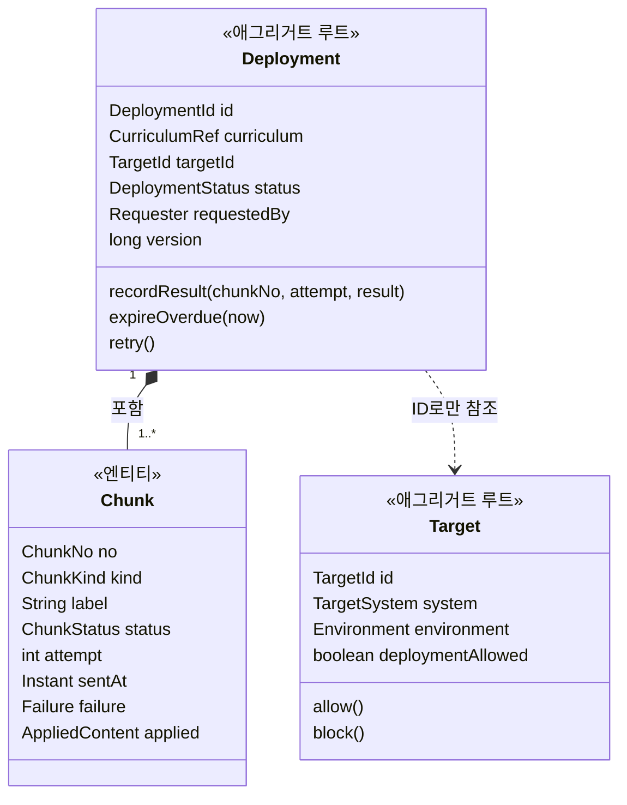
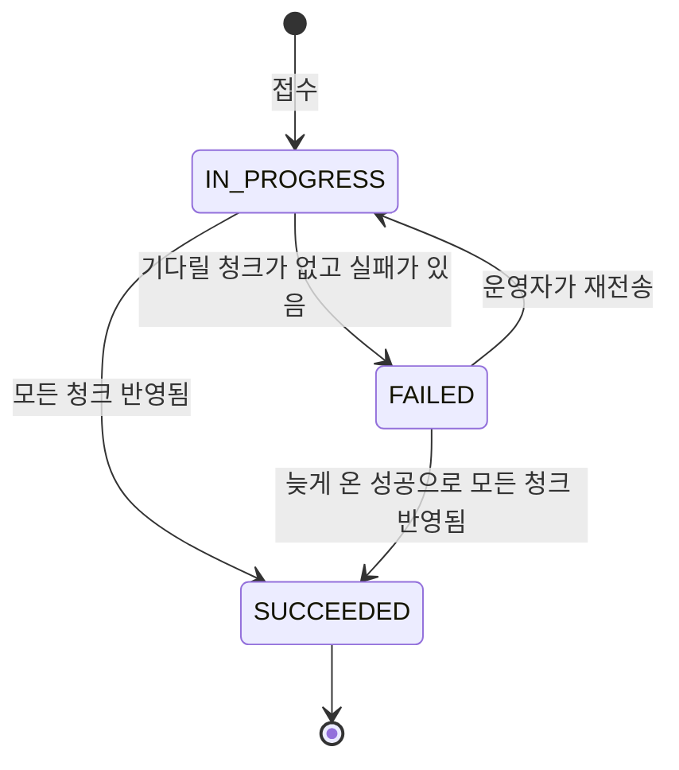
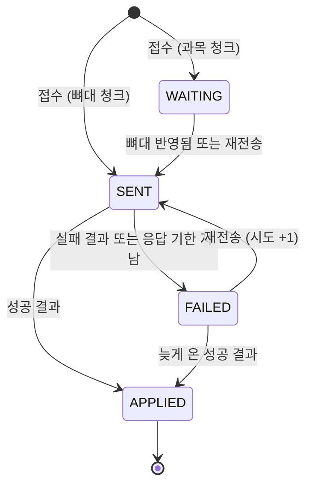

# 도메인 모델

> 도메인 설계 3단계. 배포 컨텍스트 안의 **애그리거트, 불변식, 상태 기계**를 정한다.
> 용어는 [용어집](glossary.md), 경계는 [컨텍스트 맵](context-map.md)을 따른다.
> 이 문서는 **앞으로 만들 모델**이다. 코드는 아직 이 모양이 아니다.

## 1. 출발점: 지금 코드의 문제

지금 코드에는 상태와 규칙이 있지만 업무 규칙을 지키지 못한다.

| 문제 | 근거 | 일어나는 일 |
|---|---|---|
| **0번 청크의 결과가 배포 전체의 결과가 된다** | `DataMigrationMessageListenerImpl`: `chunkOffset == 0` 일 때만 배포 상태를 바꾼다 | 뼈대가 성공하면 배포는 SUCCESS다. 그 뒤 과목 40개가 전부 실패해도 SUCCESS로 남는다. |
| **상태 기계가 쓰이지 않는다** | `Transfer.markSent()`, `markProcessed()`, `markSuccess()`를 부르는 곳이 없다. 결과 처리는 리포지토리가 상태 값을 바로 덮어쓴다 | 전이 규칙이 코드에 적혀 있지만 아무것도 막지 못한다. |
| **청크 행이 결과가 와야 생긴다** | `saveChunk`는 결과를 받을 때 행을 만들고, 0번은 행을 만들지 않는다 | "아직 안 보냄"과 "보냈는데 응답 없음"을 구별할 수 없다. |
| **재전송 결과를 기록할 수 없다** | `saveChunk`: 이미 행이 있으면 건너뛴다 | 실패한 청크를 다시 보내 성공해도 실패로 남는다. |
| **과목이 뼈대보다 먼저 도착할 수 있다** | 대상은 학기가 없으면 과목 저장에 실패한다(`findBySemesterId(...).orElseThrow()`). 그런데 청크마다 `UUID.randomUUID()`를 Kafka 키로 쓴다 | 청크가 서로 다른 파티션으로 흩어져 순서가 보장되지 않는다. |
| **응답이 안 오면 영원히 끝나지 않는다** | 응답 기한이 없다 | 배포가 진행 중으로 남는다. |
| **동시 배포를 막는 규칙이 없다** | 접수할 때 진행 중인 배포를 확인하지 않는다 | 같은 커리큘럼을 같은 대상에 동시에 보내 서로 덮어쓸 수 있다. |

공통된 원인은 **배포가 끝났는지를 판단하는 주체가 없다**는 것이다. 이 모델은 그 판단을 `Deployment` 안에 모은다.

## 2. 애그리거트



| 애그리거트 | 포함 | 한 트랜잭션에 지키는 것 |
|---|---|---|
| **Deployment** | `Chunk` 전부 | 청크 상태와 배포 상태가 항상 맞는다 |
| **Target** | 없음 | 시스템 × 환경 하나에 대상 하나, 배포 허용 여부 |

### 왜 청크를 배포 안에 넣었나

| | 방식 | 장점 | 단점 |
|---|---|---|---|
| **A** | **청크를 배포 안의 엔티티로 둔다** | 결과 하나를 받을 때 청크 상태와 배포 상태가 한 트랜잭션에서 함께 바뀐다. 청크는 배포 밖에서 뜻이 없다. | 청크 결과가 동시에 오면 같은 배포에 쓰기가 몰린다. |
| B | 청크를 별도 애그리거트로 두고 배포 상태는 나중에 맞춘다 | 쓰기가 몰리지 않는다. | 청크는 다 끝났는데 배포는 진행 중인 틈이 생기고, 맞추는 코드가 따로 필요하다. |

**A를 고른다.** 배포 하나는 청크가 수십 개라 트랜잭션이 부담되는 크기가 아니다. 쓰기가 몰리는 문제는 결과 메시지의 Kafka 키를 **배포 ID**로 두어 줄인다. 같은 배포의 결과는 한 파티션에서 차례로 처리되므로 부딪힐 일이 거의 없다. 그래도 일어나는 충돌은 `version`(낙관적 락)이 잡고 재시도한다.

### 왜 대상을 ID로만 참조하나
대상의 배포 허용을 바꾼다고 진행 중인 배포를 건드릴 일이 없다. 생명 주기가 다르다. 배포에는 대상 ID만 둔다.

### 청크 내용은 애그리거트에 넣지 않는다
과목 청크 하나는 수백 KB다(문서 약 10MB ÷ 약 40개). 결과 한 건을 처리할 때마다 전부 읽을 이유가 없다. 내용은 `ChunkPayload`로 따로 저장하고, 보낼 때만 읽는다. ([3절 불변식 4](#3-불변식))

## 3. 불변식

항상 참이어야 하는 규칙이다. **배포 안**의 규칙은 `Deployment`가 지키고, 여러 배포에 걸친 규칙은 [5절](#5-여러-애그리거트에-걸친-규칙)에서 다룬다.

| # | 불변식 | 왜 |
|---|---|---|
| 1 | 청크 구성은 접수할 때 정해지고 바뀌지 않는다. 항상 뼈대 하나 + 과목 N개다. | 완료 판단의 기준이 흔들리면 안 된다. |
| 2 | 모든 청크가 `APPLIED`일 때만, 그때는 반드시 배포가 `SUCCEEDED`다. | "0번이 성공하면 성공"인 지금의 문제를 막는다. |
| 3 | 뼈대가 `APPLIED`가 되기 전에는 과목 청크를 보내지 않는다. | 대상은 학기가 있어야 과목을 저장할 수 있다. |
| 4 | 한 배포의 청크는 모두 접수 시점의 같은 원본 내용이다. 재전송도 저장해 둔 내용을 다시 보낸다. | 원본을 다시 읽으면 재전송한 과목만 새 내용이 되어, 한 배포 안에 두 시점의 내용이 섞인다. 새 내용을 보내려면 재배포한다. |
| 5 | `APPLIED`인 청크는 다시 바뀌지 않는다. | 늦게 온 실패 결과가 성공을 덮으면 안 된다. |
| 6 | `SUCCEEDED`인 배포는 다시 바뀌지 않는다. | 끝난 배포의 기록은 믿을 수 있어야 한다. |

## 4. 상태 기계

지금의 `PENDING / SENT / PROCESSED / SUCCESS / FAILED`는 업무 상태가 아니라 처리 단계를 기록한 것이다. 업무에서 묻는 것은 "끝났나, 성공했나"이므로 상태를 줄인다.

### 배포 (DeploymentStatus)



| 상태 | 화면 | 뜻 |
|---|---|---|
| `IN_PROGRESS` | 진행 중 | 응답을 기다리는 청크가 있다 |
| `SUCCEEDED` | 완료 | 모든 청크가 대상에 반영됐다 |
| `FAILED` | 실패 | 기다릴 것이 없는데 반영되지 않은 청크가 있다. 재전송할 수 있다 |

**왜 "대기" 상태를 없앴나**: "아웃박스에 기록했지만 아직 Kafka로 안 나감"을 상태로 두려면 발행 콜백이 애그리거트를 고쳐야 한다. 그러면 발행 콜백과 결과 처리가 서로 앞서거니 뒤서거니 하는 경쟁이 생긴다. 이 차이로 운영자가 다르게 판단할 일도 없다. Kafka가 죽어 있으면 응답 기한이 지나 "응답 없음"으로 드러난다.

### 청크 (ChunkStatus)



| 상태 | 뜻 |
|---|---|
| `WAITING` | 아직 보내지 않았다. 뼈대가 반영되기를 기다린다 |
| `SENT` | 보내기로 확정했다(아웃박스에 기록함). 결과를 기다린다 |
| `APPLIED` | 대상이 반영했다고 알려 왔다 |
| `FAILED` | 반영되지 않았다. 이유는 `Failure`에 있다: `REJECTED`(대상이 실패를 알림, 오류 메시지 포함), `NO_REPLY`(기한 안에 응답 없음) |

### 시도(attempt)와 결과 처리

재전송하면 같은 청크에 결과가 두 번 올 수 있다. 메시지는 최소 한 번 전달되므로 같은 결과가 중복으로 오기도 한다. 그래서 청크마다 **시도 번호**를 두고, 명령과 결과에 함께 싣는다.

| 지금 청크 | 온 결과 | 처리 | 이유 |
|---|---|---|---|
| `SENT` | 성공 (어느 시도든) | `APPLIED` | 한 배포의 내용은 같으므로(불변식 4) 어느 시도의 성공이든 맞다 |
| `SENT` | 실패, 현재 시도 | `FAILED` | |
| `SENT` | 실패, 이전 시도 | 무시 | 지금 시도의 결과를 기다리는 중이다 |
| `FAILED` | 성공 (어느 시도든) | `APPLIED` | 기한이 지난 뒤 온 성공이다. 대상이 알려 온 사실이 추측보다 우선한다 |
| `FAILED`(`NO_REPLY`) | 실패, 현재 시도 | 이유만 `REJECTED`로 바꿈 | 더 정확한 이유를 알게 됐다 |
| `APPLIED` | 무엇이든 | 무시 | 불변식 5 |

### 응답 기한
`SENT`인 청크가 기한을 넘기면 주기적으로 `FAILED(NO_REPLY)`로 바꾼다. 기한이 없으면 응답이 유실된 배포가 영원히 진행 중으로 남아, 5절의 규칙 때문에 그 커리큘럼을 그 대상에 다시 배포할 수 없게 된다. 기한 값은 [시스템 설계](../system/) 단계에서 정한다.

### 재전송과 늦은 결과
- `FAILED`인 배포에 늦은 성공이 와도 **스스로 다시 나가지 않는다.** 뼈대의 늦은 성공이 와도 남은 과목을 자동으로 보내지 않고, 운영자가 재전송해야 나간다. 운영자가 실패를 보고 판단하는 중에 시스템이 혼자 움직이면 안 되고, 그사이 새 배포가 시작됐을 수도 있기 때문이다.
- 재전송은 `FAILED` 청크를 다시 보낸다. 뼈대가 이미 반영돼 있으면 `WAITING` 청크도 함께 보낸다.

## 5. 여러 애그리거트에 걸친 규칙

애그리거트 하나로는 지킬 수 없는 규칙이다.

### 규칙 A: 커리큘럼 × 대상마다 진행 중인 배포는 하나

| | 방식 | 평가 |
|---|---|---|
| | 접수할 때 조회해서 확인만 한다 | 동시에 두 요청이 오면 둘 다 통과한다 |
| | 커리큘럼 × 대상마다 잠금 전용 애그리거트를 둔다 | 맞지만 규칙 하나에 모델과 테이블이 하나 늘어난다 |
| **채택** | **DB 부분 유니크 인덱스**로 막고, 친절한 오류를 위해 조회도 한다 | 동시 요청까지 DB가 확실히 막는다. Postgres가 지원한다 |

```sql
CREATE UNIQUE INDEX uk_deployment_in_progress
    ON deployment (curriculum_id, target_id)
    WHERE status = 'IN_PROGRESS';
```

인덱스를 어기면 배포 쪽 오류(409)로 바꾼다. 재전송도 `IN_PROGRESS`로 돌아가므로 같은 인덱스가 지킨다. 이 규칙의 기준은 원본 저장소와 상관없다. 대상에 쓰이는 데이터는 커리큘럼 ID로 구별되기 때문이다.

### 규칙 B: 재전송은 그 커리큘럼 × 대상의 가장 최근 배포만 할 수 있다
오래된 실패 배포를 재전송하면 **더 최근 배포가 넣은 내용을 옛날 내용으로 덮어쓴다.** 재전송할 때 더 최근 배포가 있으면 거절(409)하고, 재배포를 안내한다.

### 규칙 C: 배포 허용이 꺼진 대상에는 새로 나가지 않는다
접수와 재전송 때 `Target`을 확인한다(422). 이미 나간 청크는 그대로 둔다. 허용을 끄는 것은 "새로 보내지 마라"이지 "진행 중인 것을 멈춰라"가 아니다.

## 6. 값 객체

| 값 객체 | 내용 | 비고 |
|---|---|---|
| `CurriculumRef` | 원본 저장소 ID, 커리큘럼 ID, 제목 | 제목은 접수 시점의 것을 남긴다. 원본이 바뀌어도 이력은 그대로 보인다 |
| `ChunkNo` | 0 이상 정수 | 0번이 뼈대다 |
| `ChunkKind` | `SKELETON`, `SUBJECT` | |
| `Failure` | 종류(`REJECTED`, `NO_REPLY`), 메시지, 시각 | |
| `AppliedContent` | 과목 ID, 단원 수, 차시 수 | 대상이 결과에 담아 보낸다. 검증에 쓴다 |
| `Requester` | 운영자 이름 | 로그인이 생기면 ID로 바꾼다 |

**검증**은 상태를 바꾸지 않는 계산이다. 원본의 지금 트리와 청크들의 `AppliedContent`를 비교해 `Difference` 목록을 만든다. 저장하지 않고, 배포 상태에도 영향을 주지 않는다. 그래서 대상 데이터가 원본과 달라도 배포는 `SUCCEEDED`로 남는다. "그때 보낸 것이 다 들어갔다"와 "지금 원본과 같다"는 다른 질문이기 때문이다.

## 7. 메시지 순서

### 위험: 옛 명령이 새 배포를 덮어쓴다
응답 기한이 지나 `FAILED`가 된 뒤 새 배포가 시작됐는데, Kafka에 밀려 있던 옛 명령이 그 뒤에 반영되면 새 내용을 옛 내용으로 덮는다. 규칙 A와 B는 배포 시스템 쪽 규칙이라 이것을 막지 못한다.

### 결정: 명령의 Kafka 키는 대상 + 커리큘럼 ID다
Kafka는 같은 키의 메시지를 같은 파티션에 넣고, 파티션 안에서는 순서를 지킨다. 그래서 키는 **순서를 지켜야 하는 단위**로 정한다. 대상에서 서로 덮어쓰면 안 되는 단위가 "커리큘럼 × 대상"이므로 이것을 키로 쓴다.

| 키 | 순서 보장 범위 | 평가 |
|---|---|---|
| 무작위 (지금) | 없음 | 뼈대와 과목의 순서가 뒤집힌다 |
| 배포 ID | 한 배포 안 | 옛 배포와 새 배포의 순서를 보장하지 못한다 |
| **대상 + 커리큘럼 ID** | 그 커리큘럼 × 대상의 모든 명령 | **채택.** 옛 명령이 먼저 처리되고 새 명령이 그 위에 덮어쓴다 |
| 대상 + 과목 ID | 과목별 | 동시 처리는 가장 많지만 뼈대와 과목의 순서가 뒤집힌다 |

이렇게 하면 대상이 "마지막으로 반영한 배포 순번"을 기억하는 장치 없이도 옛 명령 문제가 풀린다.

결과 메시지의 키는 [2절](#왜-청크를-배포-안에-넣었나)대로 배포 ID다. 명령과 결과는 지켜야 할 순서의 범위가 다르다.

### 키로 해결되지 않는 것: 불변식 3을 그대로 둔다
키는 **순서**만 보장하고 앞선 메시지의 **성공**은 보장하지 않는다. 뼈대가 실패해도 과목은 뒤따라 처리되어 줄줄이 실패한다. 그래서 뼈대가 반영된 뒤에 과목을 보낸다는 불변식 3은 키와 별개로 유지한다.

| 뼈대가 실패했을 때 | 키만 맞추고 다 보냄 | 뼈대 성공 후 발행 (채택) |
|---|---|---|
| 과목 청크 | 전부 줄줄이 실패 | 나가지 않음 |
| 실패 목록 | 진짜 원인 1건이 41건에 묻힘 | 1건 |
| 재전송 | 전부 | 뼈대부터 이어서 |
| 구현 | 단순함 | 결과를 받아 다음 발행을 시작해야 함 |

### 이 결정이 성립하는 조건
| 조건 | 지켜지지 않으면 | 지금 코드 |
|---|---|---|
| 아웃박스는 같은 키의 행을 생성 순서대로 발행한다. 앞 행의 발행이 실패하면 같은 키의 뒤 행을 보내지 않는다 | Kafka에 들어가기 전에 순서가 뒤집힌다 | 조회에 정렬이 없고, 실패 행을 건너뛰고 다음 행을 보낸다 |
| 토픽의 파티션 수를 운영 중에 늘리지 않는다 | 같은 키가 다른 파티션으로 가서, 옛 명령과 새 명령의 순서가 깨진다 | 파티션 3개로 고정돼 있다 |

### 감수하는 것
- **한 커리큘럼의 과목은 차례로 처리된다.** 과목끼리 동시에 처리할 수 없다. 다른 커리큘럼이나 다른 대상과는 동시에 처리된다.
- **청크 처리가 느리면 그만큼 배포가 느려진다.** 지금 대상 쪽에 메시지마다 `Thread.sleep(1000)`이 있어, 이것만으로 41개 청크에 41초가 걸린다. 지울 것이다.
- **DLT에서 옛 명령을 손으로 다시 넣으면 순서가 깨진다.** 그때는 그 사이에 새 배포가 있었는지 먼저 확인해야 한다.

## 8. 지금 화면·모의와 어긋나는 점

1단계 화면은 이 모델보다 먼저 만들어졌다. 코드 정리 때 맞출 목록이다.

| 어긋남 | 어디 | 고칠 방향 |
|---|---|---|
| "대기" 상태와 탭이 있다 | `lib/status.ts`, 배포 이력 탭 | 진행 중·완료·실패 셋으로 줄인다 |
| 모든 청크가 한꺼번에 나간다. 뼈대 실패가 과목을 막지 않는다 | `api/mock/simulation.ts` | 불변식 3을 따른다. 뼈대가 실패하면 과목은 `WAITING`으로 남는다 |
| 오래된 실패 배포도 재전송된다 (예: 시드의 `CUR011`) | `retryTransfer`, 상세 화면 버튼 | 규칙 B를 따른다. 더 최근 배포가 있으면 버튼 대신 안내를 보여 준다 |
| 허용이 꺼진 대상에도 재전송된다 | `retryTransfer` | 규칙 C를 따른다 |
| 응답 없음(`NO_REPLY`)을 볼 수 없다 | 모의 시뮬레이션, 상세 화면 | 응답이 오지 않는 시나리오를 추가한다 |
| 청크 상태가 `PENDING / SUCCESS / FAILED` 셋이다 | `api/types.ts` | `WAITING / SENT / APPLIED / FAILED`로 바꾼다 |

## 9. 다음 단계
- [이벤트와 메시지](events.md): 명령과 결과의 이름·내용, 시도 번호, 반영 내용
