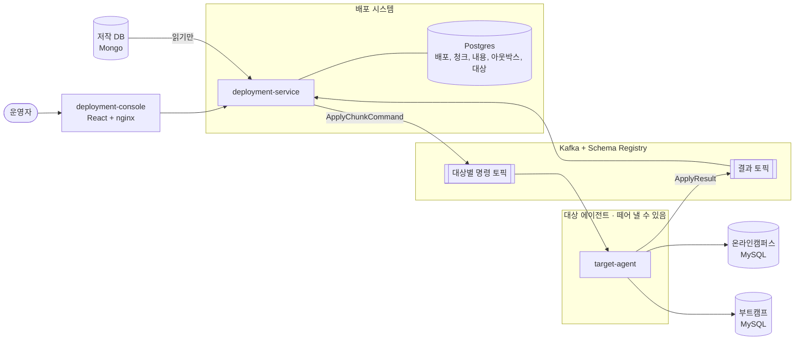

# 시스템 설계

> [도메인 모델](../domain/model.md)과 [메시지 계약](../domain/events.md)을 **어떤 구성과 어떤 값으로 돌릴지** 정한다.
> 코드는 아직 이 모양이 아니다.
> 원본을 읽어 청크로 나누는 자세한 흐름은 [원본 읽기 흐름](source-read.md)에 따로 있다.
> 값 가운데 재지 않은 것은 "임시값"이라고 적었다. 처음부터 끝까지 돌려 본 적이 아직 없기 때문이다.

## 1. 전체 구성



| 구성 요소 | 하는 일 | 가진 데이터 | 비밀 |
|---|---|---|---|
| `deployment-console` | 화면 | 없음 | 없음 |
| `deployment-service` | 접수, 청크 나누기, 발행, 결과 처리, 응답 기한 | 배포 기록의 원본 | 저작 DB 접속 정보 |
| `target-agent` | 반영하고 결과 보내기 | 없음 | 서비스 DB 접속 정보 |
| Kafka | 두 서비스 사이의 전달과 쌓아 두기 | 7일 지나면 사라지는 사본 | |

**기록의 원본은 Postgres다.** Kafka는 전달 수단이다. 재전송할 내용도 DB에서 읽으므로, 토픽의 메시지가 보관 기간이 지나 사라져도 복구할 수 있다.

## 2. 처리 흐름과 트랜잭션

어디서 죽어도 복구되려면 트랜잭션의 경계가 분명해야 한다.

| 단계 | 트랜잭션 안에서 | 트랜잭션 밖에서 |
|---|---|---|
| **접수** | 배포, 청크, 내용, 뼈대의 아웃박스 행 저장 | 그 전에 저작 DB를 읽고 청크로 나눈다 |
| **발행** | 행을 발행됨으로 표시 | 그 전에 Kafka로 보내고 브로커 응답을 받는다 |
| **반영 (대상)** | 청크 내용을 서비스 DB에 쓴다 | 커밋한 뒤 결과를 보내고, 그 뒤 오프셋을 커밋한다 |
| **결과 처리** | 청크와 배포 상태 변경, 다음에 보낼 청크의 아웃박스 행 저장 | 커밋한 뒤 오프셋을 커밋한다 |
| **응답 기한** | 기한이 지난 청크를 `FAILED(NO_REPLY)`로, 배포 상태 변경 | |

**메시지 전달은 최소 한 번이고, 효과는 한 번이다.** 어느 단계에서 죽어도 같은 일을 다시 할 뿐이고, 다시 해도 결과가 같다. Kafka 트랜잭션(정확히 한 번)은 쓰지 않는다. 대상의 DB까지 묶어 주지 못하므로, 어차피 멱등한 반영이 필요하기 때문이다.

저작 DB를 읽는 일을 트랜잭션 밖에 둔 이유는, 문서를 읽는 동안 DB 연결을 잡고 있지 않기 위해서다.

## 3. 메시지 크기

### 재 본 값
시드 생성기(`LearningMaterialDataGenerator`)와 같은 구조로 만들어 쟀다. 시드 커리큘럼 하나는 과목 40개, 단원 200개, 차시 20,000개다.

| | 과목 청크 하나 | 커리큘럼 전체 |
|---|---|---|
| JSON (지금) | 약 66KB | 약 2.6MB |
| Avro ([정한 형식](../domain/events.md#4-내용은-avro-타입으로-싣는다)), 인코딩 규칙으로 계산 | 약 32KB | 약 1.25MB |
| 뼈대 청크 (과목 ID 목록 포함, JSON) | 약 1.7KB | |

Avro는 필드 이름을 싣지 않아 절반 정도로 줄었다. 시드의 설명 글이 짧으므로 실제 콘텐츠는 더 클 수 있어서, 긴 경우도 계산했다.

| 과목 하나의 모양 | Avro 크기 |
|---|---|
| 단원 5 × 차시 100, 설명 짧음 (시드) | 약 32KB |
| 단원 10 × 차시 200, 설명 짧음 | 약 132KB |
| 단원 5 × 차시 100, 차시 설명 500자 추가 | 약 765KB |
| 단원 5 × 차시 100, 차시 설명 2,000자 추가 | 약 3MB |

### 정한 것

**과목별로 나눠 Kafka에 직접 싣고, 크기를 제한한다.** 클레임 체크와 비교한 내용은 [ADR 0005](../adr/0005-chunks-on-kafka.md)에 있다.

- **제한은 1MB로 낮춘다.** 생산자 `max.request.size`와 토픽 `max.message.bytes`를 맞춘다. 지금의 15MB 설정은 지운다.
- **청크 크기는 접수할 때 검사한다. 내용 하나가 900KB를 넘으면 배포를 접수하지 않는다(422).** 어느 과목이 얼마나 큰지 알려 준다. 발행하다 실패해 일부만 나가는 것보다 시작 전에 막는 편이 낫다.
- **압축은 `lz4`를 쓴다.** 비슷한 글이 반복되는 내용이라 잘 줄어든다. 다만 시드는 반복이 지나치게 많아 압축률을 믿을 수 없으므로, 제한 검사는 압축 전 크기로 한다.
- **바꾸는 조건**: 운영에서 제한에 자주 걸리면 클레임 체크로 간다.

## 4. Kafka 토픽

### 대상별로 나눌 것인가

지금은 모든 대상의 명령이 토픽 하나에 섞인다. [컨텍스트 맵](../domain/context-map.md#이-계약에서-바뀌는-결정)은 이것을 선택 사항으로 두고 이 단계로 미뤘다. 코드를 보니 떼어 내는 일 말고 다른 이유가 있다.

**한 대상의 문제가 다른 대상을 멈춘다.** 키가 다른 명령도 같은 파티션에 들어갈 수 있고, 대상은 [순서를 지키려고 그 자리에서 재시도](../domain/events.md#5-대상이-지켜야-할-규칙)한다. 그래서 부트캠프 DEV의 DB가 죽어 재시도하는 동안, 같은 파티션의 온라인캠퍼스 PROD 명령이 기다린다. [대상 에이전트가 지키기로 한 규칙](../domain/context-map.md#대상-에이전트-target-agent--대리-구현)에 어긋난다.

| | 방식 | 장점 | 단점 |
|---|---|---|---|
| A | 토픽 하나 (지금) | 가장 단순하다. 대상이 늘어도 토픽이 늘지 않는다 | 한 대상의 장애가 다른 대상을 민다. 서비스 팀이 남의 내용까지 읽게 된다 |
| B | 서비스 시스템별 토픽 | 팀 단위로 권한을 나눌 수 있다 | DEV의 장애와 부하가 같은 시스템의 PROD를 민다 |
| **C** | **대상별 토픽 (시스템 × 환경)** | 대상끼리 완전히 나뉜다. 토픽 단위 ACL로 자기 것만 읽게 할 수 있다. 지연도 대상별로 보인다 | 토픽이 4개다. 대상을 추가할 때 토픽도 만들어야 한다 |

**C로 정했다.** 대상은 자주 늘지 않아 단점이 작고, 나중에 바꾸려면 파티션 재배치와 순서 문제가 따라온다.

| 토픽 | 파티션 | 복제 | 보관 | 키 |
|---|---|---|---|---|
| `deployment.commands.online-campus.prod` 외 대상별 3개 | 6 | 1 | 7일 | 대상 + 커리큘럼 ID |
| `deployment.results` | 6 | 1 | 7일 | 배포 ID |
| 각 토픽의 `.DLT` | 1 | 1 | 30일 | 원본 그대로 |

- **브로커는 한 대로 시작한다.** 복제가 없어서 브로커 디스크를 잃으면 토픽의 메시지도 잃지만, 기록의 원본은 Postgres라서 미처 끝나지 않은 배포는 재전송으로 복구된다. 브로커가 내려가 있는 동안은 발행과 소비가 멈춘다. 지금 단계에는 세 대의 복잡도가 필요 없다고 판단했다. 늘릴 때는 복제 수를 3으로 올리고 `min.insync.replicas`를 2로 둔다.
- **파티션 6개**: [운영 중에 늘릴 수 없으므로](../domain/model.md#이-결정이-성립하는-조건) 지금 필요한 3개보다 넉넉히 잡는다. 파티션은 거의 비용이 없고, 소비자 수의 상한이 된다.
- **보관 7일**: 대상이 오래 내려가 있어도 복구할 시간을 준다. 지나서 사라져도 응답 기한으로 드러나고 재전송으로 복구된다.
- **DLT 30일**: 사람이 원인을 보고 판단할 시간을 준다.
- **토픽 자동 생성을 끈다.** 오타난 토픽이 파티션 기본값으로 생기면 순서 조건이 조용히 깨진다.

### 스키마를 레지스트리에 어떻게 두나

토픽이 대상별로 나뉘므로 기본 규칙(토픽 이름 + `-value`)을 쓰면 같은 스키마가 subject 네 개로 따로 관리된다. 호환성 검사와 등록도 네 번씩 해야 한다.

**`RecordNameStrategy`를 쓴다.** subject는 스키마의 전체 이름 하나다(`com.brunosong.deployment.contract.ApplyChunkCommand`). 토픽별로 다른 스키마를 강제할 수는 없지만, 모든 대상 토픽이 같은 계약을 쓰므로 필요 없다. 호환성 수준은 [`FULL`](../domain/events.md#7-스키마를-어떻게-바꿔-나가나)이고 레지스트리 전역 설정으로 둔다.

스키마 등록은 생산자의 자동 등록과 `message-contracts`의 플러그인이 맡는다. 전에 있던 `SchemaRegistryInitializer`는 지웠다. subject를 파일 이름으로 짐작했고 dev 프로필에서만 돌았다.

### 생산자와 소비자 설정

| 설정 | 값 | 이유 |
|---|---|---|
| `acks` | `all` | 지금은 브로커가 한 대라 효과가 같지만, 늘렸을 때 설정을 바꾸지 않아도 되게 둔다 |
| `enable.idempotence` | `true` | 재시도할 때 중복과 순서 뒤집힘을 막는다 |
| `min.insync.replicas` | 1 | 브로커 한 대의 값이다. 세 대로 늘리면 2로 올린다 |
| 대상 쪽 `max-poll-records` | 1 (지금과 같음) | 한 건이 오래 걸리고, 한 건씩 커밋해야 다시 처리할 양이 적다 |
| 대상 쪽 `max.poll.interval.ms` | 30분 (지금과 같음) | 그 자리 재시도 중에 그룹에서 쫓겨나 순서가 흔들리지 않게 한다 |
| 소비자 동시성 | 토픽의 파티션 수 이하 | 파티션 하나는 소비자 하나만 읽는다 |

## 5. 정한 값

| 값 | 정한 것 | 지금 | 근거 |
|---|---|---|---|
| 발행 주기 | **1초** | 10초 | [뼈대 후 과목 발행](../domain/model.md#키로-해결되지-않는-것-불변식-3을-그대로-둔다)이라 배포 하나에 두 번 이상 기다린다. 처리할 행이 없으면 인덱스 조회 한 번이라 부담이 작다 |
| 한 주기의 행 수 | 100 | | 시드 배포의 과목 40개가 한 주기에 나간다. 주기가 밀려도 다음 주기가 이어받는다 |
| 응답 기한 | **10분** (임시값) | 없음 | 아래 참고 |
| 기한 검사 주기 | 30초 | 없음 | 기한 10분에 비해 충분히 촘촘하다 |
| 대상의 그 자리 재시도 | 최대 30초, 지수 간격 | 같음 | 잠깐의 DB 끊김을 넘기되 파티션을 오래 막지 않는다 |
| 아웃박스 행 보관 | 발행 후 7일 | 지우지 않음 | 토픽 보관과 맞춰 문제를 추적할 수 있게 한다 |
| 청크 내용 보관 | 아래 참고 | 없음 | |

### 응답 기한을 어떻게 정했나

기한은 "청크 하나의 처리 시간"이 아니다. `SENT`가 된 시점부터 재므로 **자기 앞에 줄 선 청크를 기다리는 시간까지** 포함해야 한다.

```text
기한 ≥ (같은 파티션에 먼저 들어간 청크 수 × 한 건 처리 시간) + 그 자리 재시도 30초
```

한 건 처리 시간은 재지 못했다. 만약 한 건이 3초라면 시드 배포 하나가 약 2분이고, 같은 파티션에 다른 배포가 하나 더 있으면 약 4분이다. 여유를 두어 10분으로 잡고, 처음 끝까지 돌릴 때 재서 고친다.

**너무 짧아도 데이터는 망가지지 않는다.** 응답 없음으로 표시됐다가 [늦은 성공으로 바로잡히기](../domain/model.md#시도attempt와-결과-처리) 때문이다. 운영자가 헷갈릴 뿐이다. 너무 길면 응답이 유실된 배포가 그만큼 오래 진행 중으로 남고, 그동안 같은 커리큘럼을 다시 배포할 수 없다. 그래서 틀려도 덜 위험한 쪽은 조금 짧은 값이고, 설정으로 바꿀 수 있게 둔다.

## 6. 저장소

### 새로 쓰는 표

| 표 | 지금 | 주요 칸과 제약 |
|---|---|---|
| `deployment` | `deployment` | `version`, `uk_deployment_in_progress`([규칙 A](../domain/model.md#규칙-a-커리큘럼--대상마다-진행-중인-배포는-하나)) |
| `deployment_chunk` | `deployment_chunks` | `(deployment_id, chunk_no)` 유일. 상태, 시도, `sent_at`, 실패, 반영 내용 |
| `deployment_chunk_payload` | 없음 | `(deployment_id, chunk_no)` 기본 키. `content bytea`(Avro 직렬화 값) |
| `outbox` | `deployment_outbox` | `seq`, 토픽, 키, 배포 ID, 청크 번호, 시도, 상태, 발행 시각 |
| `target` | agent의 `targets` | `(system, environment)` 유일, `deployment_allowed` |

| 인덱스 | 쓰는 곳 |
|---|---|
| `outbox (seq) WHERE status = 'PENDING'` | 발행 스케줄러. 쌓인 행이 많아도 남은 행만 읽는다 |
| `deployment_chunk (sent_at) WHERE status = 'SENT'` | 응답 기한 스케줄러 |
| `deployment (curriculum_id, target_id, created_at DESC)` | 규칙 B, 대상별 최근 배포 |
| `deployment (status, created_at DESC)` | 배포 이력, 대시보드 |

### 청크 내용은 언제까지 두나

[불변식 4](../domain/model.md#3-불변식) 때문에 재전송할 가능성이 있는 동안에는 내용을 지울 수 없다. 재전송은 [가장 최근 배포만](../domain/model.md#규칙-b-재전송은-그-커리큘럼--대상의-가장-최근-배포만-할-수-있다) 할 수 있으므로 이렇게 정한다.

| 배포 | 내용 |
|---|---|
| `IN_PROGRESS`, 또는 가장 최근의 `FAILED` | 둔다 |
| `SUCCEEDED` | 지운다. 검증은 내용이 아니라 반영 내용으로 한다 |
| 더 최근 배포가 있는 `FAILED` | 지운다. 재전송할 수 없다 |

- 지우는 일은 주기 작업으로 한다. 결과 처리 트랜잭션을 무겁게 하지 않기 위해서다.
- **늦은 성공에 주의한다.** 재전송으로 시도 2의 아웃박스 행이 남아 있는데 시도 1의 성공이 와서 `SUCCEEDED`가 되면, 내용이 지워진 뒤 그 행을 발행하려 할 수 있다. 발행할 때 내용이 없으면 **보낼 필요가 없어진 행으로 보고 닫는다.**
- 크기: 커리큘럼 300개 × 대상 4곳이 모두 실패 상태인 최악의 경우에도 시드 기준 약 1.5GB다. 평소에는 훨씬 작다.

### 여러 인스턴스

| 일 | 방법 |
|---|---|
| 발행 스케줄러 | Postgres 어드바이저리 락으로 하나만 돈다 ([ADR 0004](../adr/0004-transactional-outbox.md)) |
| 응답 기한, 정리 작업 | 같은 방법. 겹쳐 돌아도 `version`이 막지만 헛일을 줄인다 |
| 결과 처리 | 키가 배포 ID라 같은 배포는 소비자 하나가 처리한다. 리밸런스 때의 겹침은 `version` 충돌 후 재시도로 처리한다 |
| API | 상태가 없어 여러 대 띄울 수 있다 |

## 7. 일이 잘못됐을 때

| 장애 | 일어나는 일 | 복구 |
|---|---|---|
| **저작 DB 다운** | 새 접수만 실패한다 (503). 진행 중인 배포와 재전송은 저장한 내용을 쓰므로 영향이 없다 | 살아나면 다시 요청 |
| **Postgres 다운** | 접수, 발행, 결과 처리가 멈춘다. 결과 소비는 오프셋을 커밋하지 않아 재시도하다 DLT로 갈 수 있다 | 아래 주의 참고 |
| **Kafka 다운** | 아웃박스에 행이 쌓인다. 대상은 할 일이 없다. 기한이 지나면 `NO_REPLY`가 된다 | 살아나면 차례로 나가고 늦은 성공으로 바로잡힌다 |
| **Schema Registry 다운** | 이미 받아 둔 스키마는 캐시로 돈다. 서비스를 새로 띄우면 처음 조회에서 실패한다 | 살아나면 재시도로 이어진다 |
| **대상 DB 다운** | 그 자리에서 30초 재시도 후 `Rejected`. 그 대상의 토픽만 영향을 받는다 | 고친 뒤 재전송 |
| **target-agent 다운** | 그 토픽에 쌓이고 기한이 지나 `NO_REPLY`가 된다 | 살아나면 밀린 명령을 차례로 처리한다 |
| **deployment-service 다운** | 결과가 토픽에 쌓인다. 발행이 멈춘다 | 다시 뜨면 이어서 처리한다. 다른 인스턴스가 있으면 락을 넘겨받는다 |
| **독 메시지** (해석 불가) | 바로 DLT로 간다. 그 파티션은 다음으로 넘어간다 | 명령은 기한이 지나 드러난다. 재전송 |

**주의: 결과가 DLT로 가면 안 된다.** 코드를 읽어 보면 지금의 공통 에러 핸들러는 어떤 오류든 30초 재시도 후 DLT로 보낸다. Postgres가 1분만 내려가도 멀쩡한 결과들이 DLT로 가서 청크가 `NO_REPLY`로 남는다. 결과 소비자는 **일시적 오류면 재시도를 그치지 않고 기다리도록** 나눈다. 뒤의 결과가 밀리지만 잃는 것보다 낫다. 해석할 수 없는 결과만 DLT로 보낸다.

**DLT를 다시 넣을 때**는 [순서가 깨질 수 있으므로](../domain/model.md#감수하는-것) 자동 재처리를 만들지 않는다. 사람이 보고, 재전송으로 복구하는 것을 기본으로 한다.

## 8. 관측

운영자는 화면에서 배포를 보고, 개발자는 아래 지표로 시스템을 본다.

| 지표 | 무엇을 알려 주나 | 경보 기준 (임시값) |
|---|---|---|
| 가장 오래된 `PENDING` 아웃박스 행의 나이 | Kafka나 스케줄러가 멈췄다 | 1분 초과 |
| 대상별 명령 토픽의 컨슈머 랙 | 대상이 밀리고 있다 | 10분 넘게 증가 |
| 결과 토픽의 컨슈머 랙 | 배포 시스템이 밀리고 있다 | 5분 넘게 증가 |
| DLT 메시지 수 | 사람이 봐야 할 메시지가 생겼다 | 1건 이상 |
| 대상별 `NO_REPLY` 건수 | 대상이 응답하지 않는다 | 연속 발생 |
| 청크 하나의 반영 시간 | 응답 기한을 정할 근거 | 경보 없음 |

- 도구는 Actuator + Prometheus + Grafana를 쓴다. Phase 5에서 설치한다.
- 로그에 `deploymentId`, `chunkNo`, `attempt`를 넣는다. 한 배포를 두 서비스에 걸쳐 찾을 수 있다.
- 분산 추적은 지금 하지 않는다. 흐름이 단순하고 위 세 값으로 충분하다.

## 9. 배포 구성

| 항목 | 정한 것 |
|---|---|
| `deployment-service` | 2대. 어드바이저리 락 덕분에 함께 돌 수 있다 |
| `target-agent` | 1대로 시작하고 파티션 수까지 늘릴 수 있다. 서비스 팀에 넘기면 대상별로 뺀다 |
| 스키마 관리 | **Flyway.** 아래 참고 |
| 설정 | config-service를 유지한다 |
| 비밀 | k8s Secret. 서비스 DB 접속 정보는 `target-agent`에만 준다 ([ADR 0002](../adr/0002-target-agent.md)) |
| 토픽 권한 | 서비스 팀에 넘길 때 토픽 ACL을 건다. 지금은 쓰는 쪽이 하나라 적용하지 않는다 |

**Flyway를 가장 먼저 해야 한다.** 지금은 모든 프로필에서 `sql.init.mode: always`이고 스키마 파일이 `DROP TABLE`로 시작한다. **서비스를 다시 띄우면 배포 기록과 아웃박스가 모두 지워진다.** 이 문서의 복구 설명은 재시작 후에도 데이터가 남아야 성립한다.

### Redis를 뺀다

지금 Redis는 세 가지에 쓰인다.

| 쓰는 곳 | 내용 | 없어도 되는 이유 |
|---|---|---|
| 배포 시스템 `DeploymentCachePort` | 배포의 총 청크 수 | 청크가 애그리거트 안에 들어오므로 DB에서 함께 읽는다 |
| 에이전트 `TargetHandler` | 대상 정보 | 대상을 메시지 값으로 고르게 되어 조회가 사라진다 |
| 에이전트 `CurriculumCachePort` | 반영한 커리큘럼의 ID | 저장만 하고 읽는 곳을 찾지 못했다 |

새 모델에서는 쓸 곳이 없다. 결과 하나를 처리하는 데 DB 조회 몇 번이면 되고, 배포량이 많지 않아 캐시가 필요한 부하도 아니다. 캐시를 두면 DB와 어긋나는 경우만 늘어난다. **뺀다.** 부하를 재 보고 필요해지면 그때 넣는다.

## 10. 재 봐야 할 것

| 항목 | 왜 | 언제 |
|---|---|---|
| 청크 하나의 반영 시간 | 응답 기한의 근거. 지금 값은 추정이다 | 처음 끝까지 돌릴 때 |
| 실제 Avro 직렬화 크기 | 이 문서의 값은 인코딩 규칙으로 계산한 값이다 | 스키마를 만든 뒤 |
| `lz4` 압축률 | 시드는 반복이 많아 믿을 수 없다 | 실제와 비슷한 데이터로 |
| 시드 기준 배포 하나의 전체 시간 | 발행 주기 1초가 적당한지 | 처음 끝까지 돌릴 때 |
| 실제 콘텐츠의 크기 | 1MB 제한이 현실적인지. 시드의 차시 설명은 아주 짧다 | 실제와 비슷한 데이터를 구할 때 |

## 11. 지금 코드에서 바뀌는 것

| 지금 | 바꿀 것 |
|---|---|
| 스키마 파일의 `DROP` + `sql.init.mode: always` | Flyway |
| 토픽 `data-migration-request`, `data-migration-response` (파티션 3) | 4절의 토픽 |
| `max.request.size: 15000000`, `KAFKA_MESSAGE_MAX_BYTES: 15728640` | 1MB |
| 압축 없음 | `lz4` |
| 발행 주기 10초 | 1초 |
| 대상 쪽 `Thread.sleep(1000)` | 삭제 |
| 공통 에러 핸들러: 모든 오류를 30초 재시도 후 DLT | 일시적 오류는 대상은 `Rejected`, 결과 소비자는 계속 재시도 |
| 배포마다 `TargetHandler`로 대상 표 조회 | 메시지 값으로 어댑터와 DB 선택 |
| Redis 모듈 `deployment-cache`, `target-agent-cache` | 삭제 |
| 지표 노출 없음 (`refresh`, `busrefresh`만 공개) | Actuator 지표 공개 |
