# 원본을 읽어 청크로 나누는 흐름

> 배포를 접수할 때 **원본 저장소에서 커리큘럼 문서 하나를 꺼내 청크 목록으로 바꾸기까지**를 다룬다.
> 청크를 저장하고 아웃박스에 넣는 뒤쪽 일은 다루지 않는다([시스템 설계 2장](architecture.md#2-처리-흐름과-트랜잭션)).
> 2026-11-12 코드 기준이다. 클래스 이름은 코드 그대로 적었다.

## 0. 한눈에

네 부분으로 나뉜다. 각 부분은 아래 장에서 따로 본다.

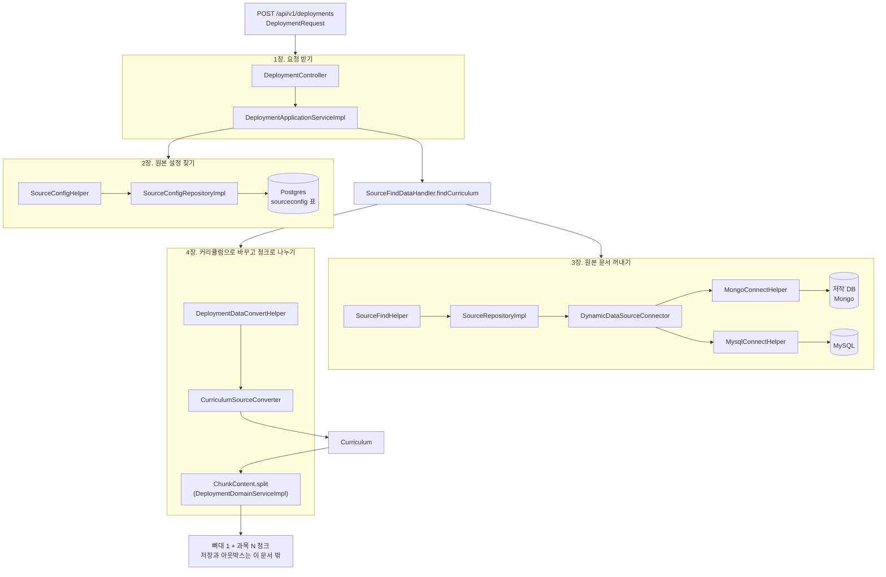

애플리케이션 서비스가 2, 3장을 차례로 부르고, 4장의 나누기는 도메인 서비스가 한다.

```java
// DeploymentApplicationServiceImpl
SourceConfig sourceConfig = sourceConfigHelper.findSourceConfigInfo(deployment.getSourceConfigId());   // 2장
Curriculum curriculum = sourceFindDataHandler.findCurriculum(deployment.getSourceId(), sourceConfig);   // 3장, 4장 앞
Deployment sent = deploymentExecutionHandler.sendData(deployment, sourceConfig, curriculum);

// DeploymentDomainServiceImpl (sendData 안에서 불린다)
List<ChunkContent> chunks = ChunkContent.split(curriculum);                                            // 4장 뒤
```

### 객체가 바뀌는 순서

같은 데이터가 단계마다 어떤 모양이 되는지 먼저 본다. 화살표마다 **새 객체**가 나오고, 앞의 객체는 고치지 않는다([7장](#7-원본-문서-커리큘럼-청크를-나눈다)).

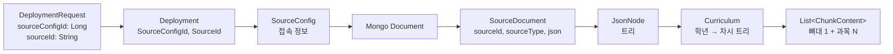

| 단계 | 객체 | 있는 모듈 | 누가 만드나 |
|---|---|---|---|
| 요청 | `DeploymentRequest` | application-service (`dto/create`) | Spring이 JSON 본문으로 만든다 |
| 배포 | `Deployment` | domain-core | `DeploymentDataMapper` |
| 원본 설정 | `SourceConfigEntity` → `SourceConfig` | dataaccess → domain-core | JPA, `SourceDataAccessMapper` |
| 원본 문서 | `Document` → `byte[]` | dataaccess | Mongo 드라이버, `MongoConnectHelper.toJson` |
| 꺼낸 문서 | `SourceDocument` | application-service (`ports/output/repository`) | `SourceDataAccessMapper` |
| 파싱한 트리 | `JsonNode` | application-service 안에서만 | `ObjectMapper.readTree` |
| 커리큘럼 | `Curriculum` | domain-core | `CurriculumSourceConverter` |
| 청크 내용 | `ChunkContent` | domain-core | `ChunkContent.split` |

## 1. 요청 받기

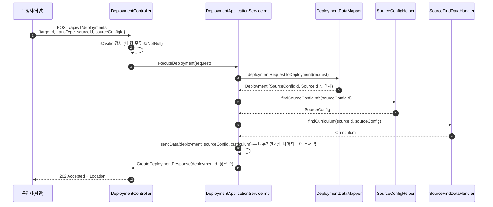

요청 본문에서 이 문서에 관계있는 칸은 둘이다.

| 칸 | 뜻 | 예 |
|---|---|---|
| `sourceConfigId` | **어느 원본 저장소**에서 읽을지. `sourceconfig` 표의 키 | `1` |
| `sourceId` | 그 저장소 안의 **어느 문서**인지. Mongo면 `_id`(24자리 16진수) | `"6731a2b4c5d6e7f801234567"` |

이름이 비슷해서 헷갈린다. `sourceConfigId`는 "어디서", `sourceId`는 "무엇을"이다([용어집](../domain/glossary.md)의 원본 저장소).

## 2. 원본 설정 찾기

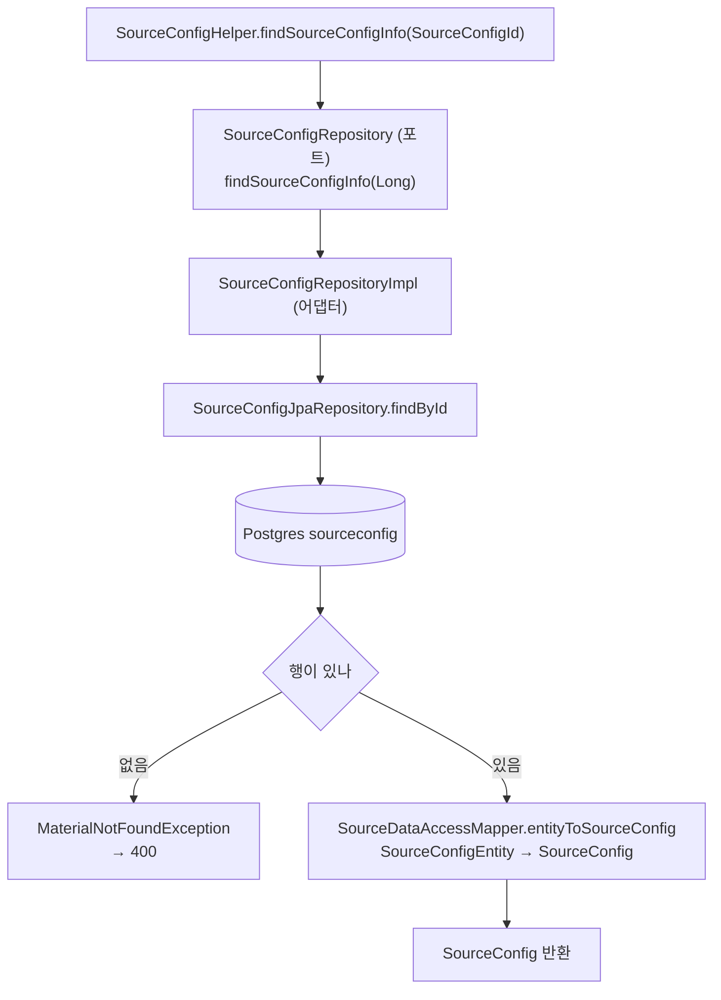

`SourceConfig`는 접속 정보 묶음이다. 표의 칸이 그대로 옮겨진다.

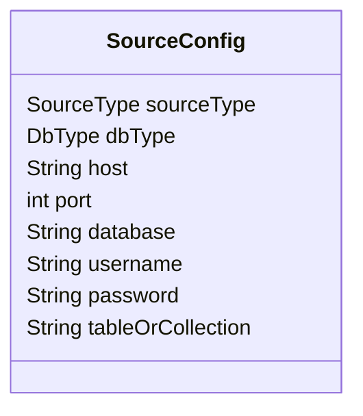

| 칸 | 값 | 쓰는 곳 |
|---|---|---|
| `sourceType` | `CURRICULUM`, `EXAM_RESULT_DATA` | 4장. 커리큘럼으로 나눌지 정한다 |
| `dbType` | `MONGO`, `MYSQL`, `POSTGRESQL`, `ORACLE`, `H2` | 3장. 어느 헬퍼로 읽을지 정한다 |
| `host`, `port`, `database`, `username`, `password` | 접속 정보 | 3장. 연결 풀을 만든다 |
| `tableOrCollection` | Mongo면 컬렉션, MySQL이면 표 이름 | 3장. 조회 대상 |

## 3. 원본 문서 꺼내기

### 3.1 호출 순서

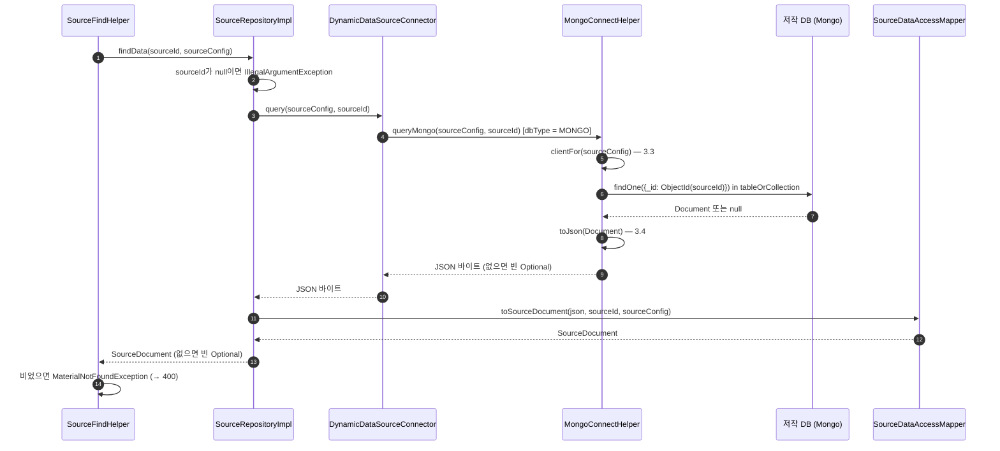

### 3.2 DB 종류로 길이 갈린다

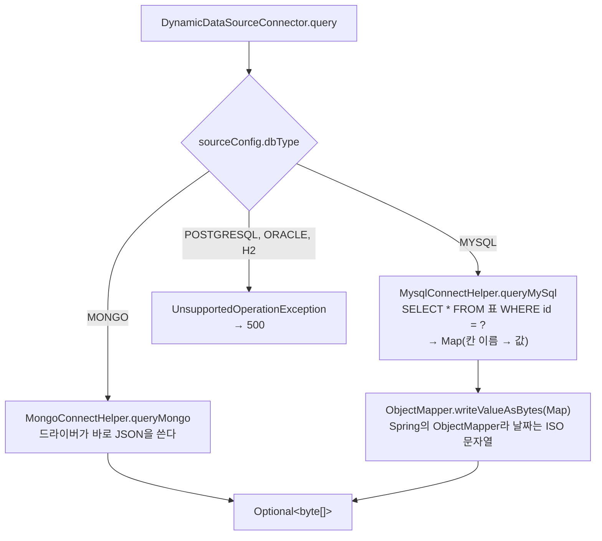

어느 길로 와도 결과는 **JSON 바이트**다. 원본마다 JSON을 만드는 방법이 달라서 여기서 통일한다.

경계를 `JsonNode`나 `Document`가 아니라 `byte[]`로 둔 이유: 포트는 application-service에 있고, 어댑터마다 JSON을 만드는 방법이 다르다. Jackson이나 BSON 타입을 포트에 드러내지 않으려는 것이다.

### 3.3 연결 풀은 원본 설정마다 하나

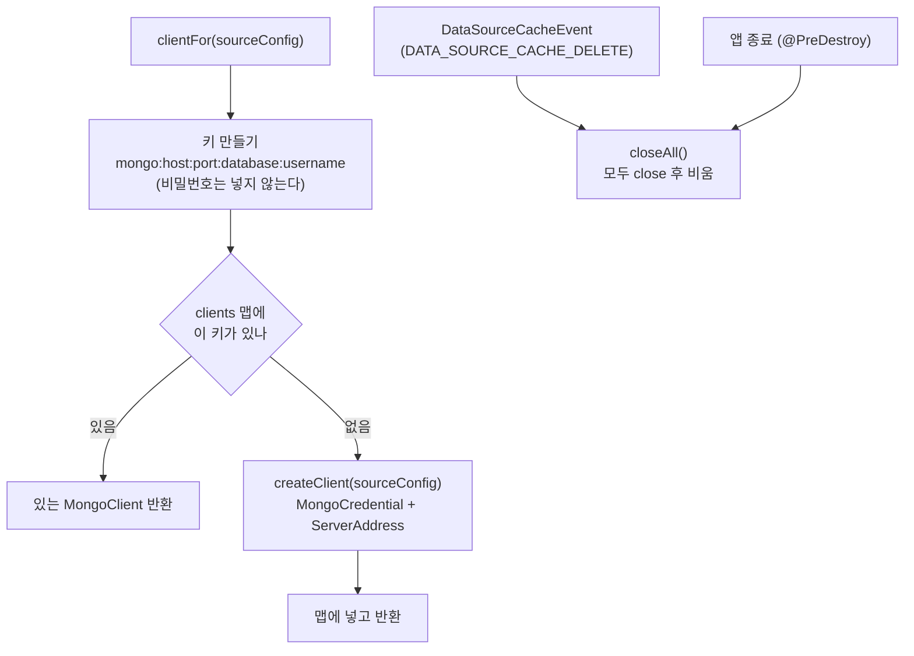

- "있나 보고, 없으면 만들어 넣기"를 `ConcurrentHashMap.computeIfAbsent` 한 번으로 한다. 같은 키로 동시에 와도 풀은 하나만 생긴다.
- MySQL(`MysqlConnectHelper`)도 같은 모양이다. 키는 `datasource:dbType:host:port:database`이고, 값은 `HikariDataSource`다.
- 캐시를 비우는 이벤트는 받는 쪽만 있다. **보내는 곳은 아직 없다.** 원본 설정을 고치는 기능이 생기면 그곳에서 보낸다.

### 3.4 Mongo 문서를 JSON으로 바꾸는 규칙

`MongoConnectHelper.JSON_SETTINGS`가 정한다. 대상이 Mongo 전용 모양을 몰라도 되게 하려는 것이다([ADR 0006](../adr/0006-chunk-content-contract.md)).

| Mongo 값 | JSON | 예 |
|---|---|---|
| `ObjectId` | 16진 문자열 | `"6731a2b4c5d6e7f801234567"` |
| `Date` | ISO-8601 UTC 문자열 | `"2026-11-11T00:00:00Z"` |
| `Int32`, `Int64`, `Double` | 숫자 그대로 (RELAXED 모드) | `3` |
| 문자열, 배열, 문서 | 그대로 | |

### 3.5 이 단계가 끝나면

```java
// application-service, 포트 SourceRepository 옆
public record SourceDocument(String sourceId, SourceType sourceType, byte[] json) { }
```

| 칸 | 채우는 곳 |
|---|---|
| `sourceId` | 요청의 `sourceId` |
| `sourceType` | 원본 설정 |
| `json` | 원본 문서 JSON (3.2절) |

- 도메인 객체가 아니다. 포트가 돌려주는 데이터일 뿐이고, JSON을 해석하는 것은 4장의 변환기다.
- `record`라 만든 뒤 바뀌지 않는다. 4장은 이것을 읽기만 하고 새 `Curriculum`을 만든다.
- `dbType`은 넣지 않았다. 어떻게 읽었는지는 꺼낸 뒤에는 알 필요가 없다.

## 4. 커리큘럼으로 바꾸고 청크로 나누기

### 4.1 원본 문서의 모양

저작 DB의 문서 하나가 커리큘럼 하나다. 칸 이름은 `CurriculumBaseKey`에 있다.

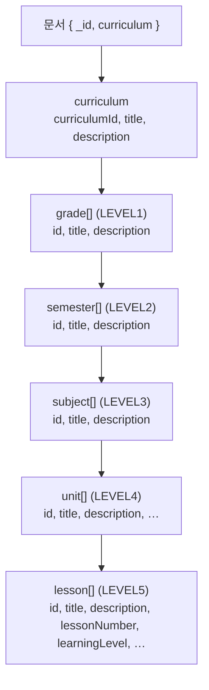

예(줄였다):

```json
{
  "_id": "6731a2b4c5d6e7f801234567",
  "curriculum": {
    "curriculumId": "CUR001", "title": "중등", "description": "중등 과정",
    "grade": [{
      "id": "G1", "title": "1학년",
      "semester": [{
        "id": "S1", "title": "1학기",
        "subject": [
          { "id": "SUB1", "title": "국어",
            "unit": [{ "id": "U1", "title": "단원 1",
              "lesson": [{ "id": "L1", "title": "차시 1", "lessonNumber": 1, "learningLevel": 3, "format": "Video" }] }] },
          { "id": "SUB2", "title": "수학", "unit": [] }
        ]
      }]
    }]
  }
}
```

### 4.2 바꾸고 나누는 순서

두 단계로 나뉜다. **커리큘럼으로 바꾸기**는 원본 쪽 일이고, **청크로 나누기**는 배포 쪽 일이다([컨텍스트 맵](../domain/context-map.md): 원본은 커리큘럼 트리만 주고 배포가 나눈다).

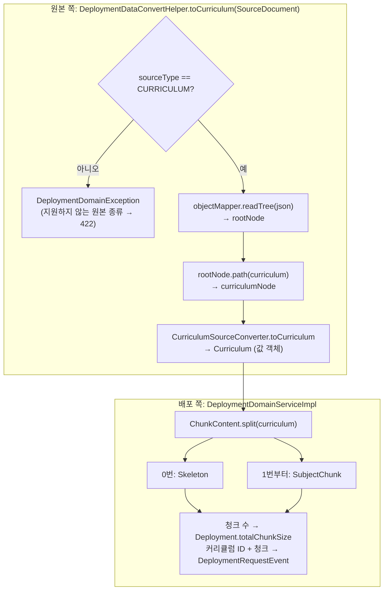

목록의 순서가 곧 청크 번호다. 배포는 청크 수만 기억하고, 청크 내용과 커리큘럼 ID는 청크마다 하나씩 만드는 이벤트에 싣는다.

### 4.2.1 Curriculum

원본 문서의 트리를 그대로 옮긴 값 객체다. 청크 번호나 뼈대 같은 배포의 말은 들어 있지 않다.

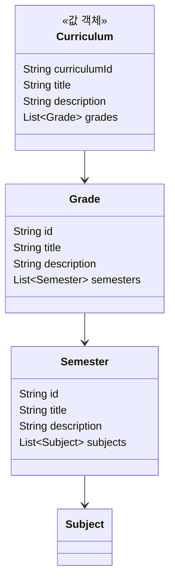

`Subject`, `Unit`, `Lesson`은 `Curriculum` 안에 있다(4.4절 그림). 모두 `record`이고 목록은 `List.copyOf`로 복사해 둔다. 만들 때 `curriculumId`와 `title`이 비어 있으면 `DeploymentDomainException`을 던진다.

### 4.3 문서 하나가 청크 여러 개가 된다

위 예의 문서는 청크 셋이 된다.

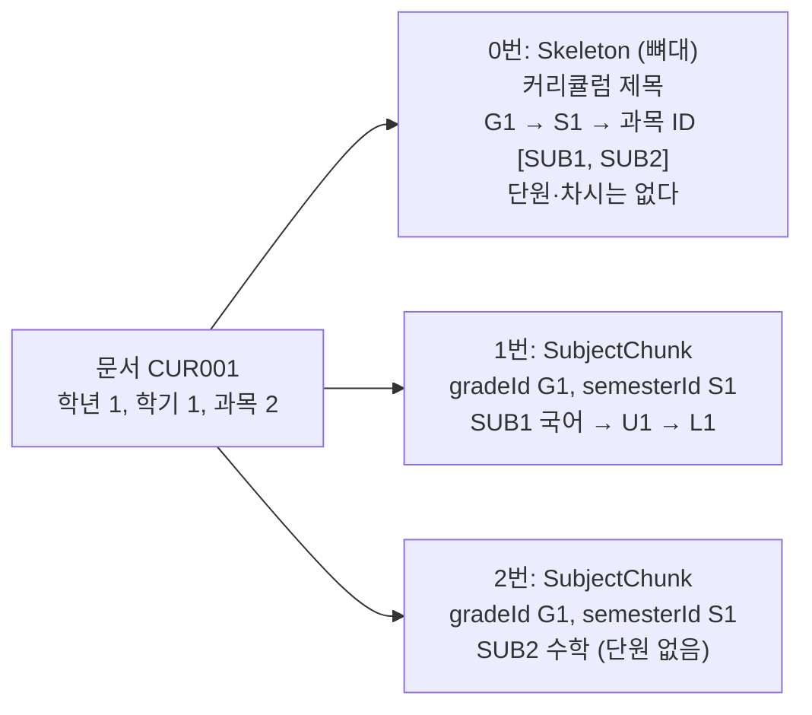

- **뼈대(0번)**는 학기까지와 학기별 과목 ID 목록만 담는다. 대상은 이 목록에 없는 과목을 서비스에서 뺀다([이벤트와 메시지 6절](../domain/events.md#6-원본에서-지운-과목은-대상에서도-뺀다)).
- **과목 청크(1번부터)**는 과목 하나와 그 아래 단원, 차시 전부를 담는다. 어느 학년, 학기의 과목인지도 함께 담는다.
- 과목 청크 수는 문서 전체의 과목 수다. 시드 문서(학년 4 × 학기 2 × 과목 5)라면 뼈대 1 + 과목 40 = 청크 41개다.

### 4.4 만들어지는 객체

`ChunkContent`(domain-core)는 sealed interface이고, 청크는 `Skeleton`이나 `SubjectChunk` 둘 중 하나다. `sealed`라서 다른 종류는 만들 수 없고, 메시징 매퍼의 `switch`는 `default` 없이 두 경우만 다룬다.

뼈대용 `Grade`, `Semester`는 커리큘럼의 것과 따로 있다. 뼈대의 학기는 과목 **ID 목록**만 가진다. 과목 내용을 실으면 메시지가 커지고, 단원을 비워 실으면 대상이 "단원이 없다"로 읽고 지워 버리기 때문이다. 과목 청크는 `Curriculum.Subject`를 그대로 담는다. 청크가 커리큘럼을 나눈 결과라서다.

그림에서 `SkeletonGrade`, `SkeletonSemester`는 코드의 `ChunkContent.Grade`, `ChunkContent.Semester`이고, `Subject`, `Unit`, `Lesson`은 `Curriculum.Subject`, `Curriculum.Unit`, `Curriculum.Lesson`이다.

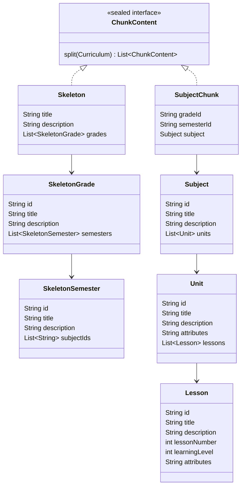

### 4.5 어느 칸이 어디로 가나

| 원본 칸 | 필수? | 어디로 |
|---|---|---|
| `curriculum.curriculumId` | 필수 | `Curriculum.curriculumId`. 청크 안에는 없고, 청크마다 만드는 `DeploymentRequestEvent`에 실린다 |
| 모든 단계의 `id`, `title` | 필수 | 같은 이름의 칸 |
| 모든 단계의 `description` | 없어도 됨 | 같은 이름의 칸, 없으면 `null` |
| 차시 `lessonNumber` | 필수 (정수) | `Lesson.lessonNumber` |
| 차시 `learningLevel` | 필수 (정수) | `Lesson.learningLevel`과 `Lesson.attributes` 둘 다. 받는 쪽이 옮겨 가면 `attributes`에만 남는다 |
| 단원, 차시의 **나머지 칸 전부** | 검사 안 함 | `attributes` (JSON 객체 문자열, 원본 순서 그대로) |
| 학년, 학기, 과목의 나머지 칸 | | 버린다 |
| 문서의 `_id` | | 버린다 (`sourceId`로 이미 안다) |

위 예의 차시 `L1`은 이렇게 된다.

```text
Lesson(id="L1", title="차시 1", description=null, lessonNumber=1, learningLevel=3,
       attributes="{\"learningLevel\":3,\"format\":\"Video\"}")
```

단원 `U1`은 아는 칸과 `lesson` 말고는 칸이 없어서 `attributes="{}"`다.

### 4.6 검사

원본 칸 이름을 아는 곳은 `CurriculumSourceConverter` 한 곳뿐이다. 검사도 여기서 한다.

| 메서드 | 하는 일 | 실패하면 |
|---|---|---|
| `requiredText(node, 칸)` | 문자열이 있어야 한다 | `IllegalArgumentException("저작 문서에 문자열 필드 'title' 가 없습니다: id=L1")` |
| `requiredInt(node, 칸)` | 정수가 있어야 한다 | 같은 모양, "정수 필드" |
| `optionalText(node, 칸)` | 문자열이면 값, 아니면 `null` | 실패하지 않는다 |

오류 메시지에는 문서 전체가 아니라 그 노드의 `id`만 넣는다. 문서가 커서다.

## 5. 실패하면

| 어디서 | 상황 | 예외 | 응답 |
|---|---|---|---|
| 1장 | 요청 칸이 비었다 | `MethodArgumentNotValidException` | 400, 어느 칸인지 |
| 2장 | `sourceConfigId`에 맞는 설정이 없다 | `MaterialNotFoundException` | 400 |
| 3장 | `sourceId`가 ObjectId 모양(24자리 16진수)이 아니다 | `IllegalArgumentException` | 500 |
| 3장 | 지원하지 않는 DB 종류다 | `UnsupportedOperationException` | 500 |
| 3장 | Mongo에 붙지 못한다 | `MongoTimeoutException` (서버 선택 30초 뒤) | 500 |
| 3장 | 문서가 없다 | `MaterialNotFoundException` | 400 |
| 4장 | 원본 종류가 `CURRICULUM`이 아니다 | `DeploymentDomainException` | 422 |
| 4장 | 원본 문서가 JSON이 아니다 | `IllegalStateException` | 500 |
| 4장 | 필수 칸이 없거나 타입이 다르다 | `IllegalArgumentException` (감싸지 않는다) | 500 |
| 4장 | 커리큘럼 ID나 제목이 비었다 (`Curriculum` 검사) | `DeploymentDomainException` | 422. 변환기 검사가 먼저 걸리므로 보통은 위 줄이 난다 |

500은 공통 처리기(`GlobalExceptionHandler`)가 `"Unexpected error!"`로 돌려준다. 그래서 운영자는 무엇이 잘못됐는지 알 수 없다. 아래 6장에 적었다.

## 6. 지금 남은 문제

| # | 문제 | 고칠 방향 |
|---|---|---|
| 1 | 4장의 필수 칸 오류가 500이 된다. 이제 감싸지는 않지만 `IllegalArgumentException`을 받는 처리기가 없다 | 원본 문서 오류용 예외를 두고 422로 돌려준다. 어느 차시의 어느 칸인지 운영자가 봐야 한다 |
| 2 | `sourceId`가 ObjectId 모양이 아니면 500이 된다 | 400으로 돌려준다 |
| 3 | 원본 설정이 없을 때 메시지가 "Not found sourceContentData"다 | "원본 저장소가 없다"로 고친다 |
| 4 | MySQL 원본은 행 하나를 평평한 Map으로 읽는다. 변환기는 `curriculum` 아래 트리를 기대하므로 MySQL 원본으로는 커리큘럼을 나눌 수 없다 | MySQL 원본을 계속 둘지 정한다. 둔다면 행을 트리로 바꾸는 방법이 따로 있어야 한다 |
| 7 | 캐시를 비우는 `DataSourceCacheEvent`를 보내는 곳이 없다 | 원본 설정 수정 기능을 만들 때 보낸다 |

2026-11-12에 푼 것:

| # | 문제 | 어떻게 풀었나 |
|---|---|---|
| 5 | `sourceType`이 `EXAM_RESULT_DATA`면 오류 없이 청크 0개가 됐다 | `DeploymentDataConvertHelper`가 `DeploymentDomainException`(422)으로 거절한다 |
| 6 | `SourceContentData`가 원본 JSON을 나눈 뒤에도 들고 다녔다 | [7장](#7-원본-문서-커리큘럼-청크를-나눈다)대로 꺼낸 문서, 커리큘럼, 청크로 나누고 `SourceContentData`를 지웠다 |

## 7. 원본 문서, 커리큘럼, 청크를 나눈다

> 2026-11-12에 정하고 같은 날 코드에 반영했다. 0~6장은 바꾼 뒤의 코드다. 이 장은 무엇이 왜 바뀌었는지 남긴 기록이라 바꾸기 전 이름이 나온다.

### 7.1 문제

`SourceContentData`는 `valueobject` 패키지에 있지만 값 객체가 아니다.

| 값 객체라면 | 지금 |
|---|---|
| 만든 뒤 바뀌지 않는다 | `updateCurriculumId`, `updateChunkDataList`로 바뀐다 |
| 값이 같으면 같은 것이다 | `equals`가 없다. `byte[]`는 값으로 비교되지도 않는다 |
| 뜻이 하나다 | 꺼낸 문서(JSON), 문서 안의 커리큘럼 ID, 나눈 청크가 한 객체에 섞여 있다 |

그래서 이런 일이 생긴다.

- `splitCurriculumJsonIntoChunks`는 청크 목록을 돌려주면서, 받은 인자의 `curriculumId`도 몰래 채운다. 시그니처만 봐서는 모른다.
- 나눈 뒤에도 원본 JSON을 들고 다니고, `Deployment`가 이 객체를 칸으로 들고 있다. [도메인 모델](../domain/model.md#청크-내용은-애그리거트에-넣지-않는다)의 "청크 내용은 애그리거트에 넣지 않는다"와 어긋난다.
- `chunkOffset` 칸 하나를 여러 뜻으로 쓴다. 접수 때는 아무도 채우지 않는데 `DeploymentDataAccessMapper`가 이것을 `totalChunkSize`로 저장한다. [ROADMAP](../ROADMAP.md)의 "`totalChunkSize`가 0으로 저장됨"이 이것이다.
- 청크로 나누는 일이 원본 쪽 변환기(`CurriculumSourceConverter`) 안에 있다. [컨텍스트 맵](../domain/context-map.md)은 "원본은 커리큘럼 트리만 주고 배포가 나눈다"고 정했다. 어떻게 나눌지(뼈대 먼저, 과목은 따로)는 배포의 규칙이기 때문이다.

### 7.2 선택지

| 안 | 내용 | 얻는 것 | 남는 문제 |
|---|---|---|---|
| A | 값 객체가 아니라고 인정하고 패키지만 옮긴다 | 고칠 곳이 적다 | 위 문제가 그대로다 |
| B | 불변으로 바꾸고 `withChunks(...)`처럼 복사본을 돌려준다 | 숨은 부작용이 없어진다 | 여러 뜻이 한 객체에 섞여 있고, 원본 JSON도 계속 따라다닌다 |
| **C** | **단계마다 객체를 따로 둔다.** 원본은 커리큘럼 트리를 주고, 배포가 그것을 청크로 나눈다 | 단계마다 필요한 칸만 있다. 컨텍스트 맵의 경계와 맞는다 | `Deployment`와 저장·메시징 매퍼까지 고쳐야 한다 |

**C를 고른다.** 흐름이 원래 "꺼낸다 → 커리큘럼으로 바꾼다 → 청크로 나눈다"라서 객체도 그대로 나누는 것이 가장 자연스럽다.

### 7.3 한눈에

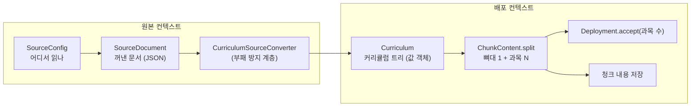

| 객체 | 뜻 | 누구 것 | 도메인 객체인가 | 언제까지 쓰나 |
|---|---|---|---|---|
| `SourceConfig` | **어디서** 읽나. 접속 정보 | 원본 | 엔티티 (식별자 있음) | 오래 산다. 운영자가 등록하고 끈다 |
| `SourceDocument` | 꺼낸 문서 그대로 | 원본 | **아니다.** 포트가 돌려주는 데이터다. JSON은 도메인이 해석하지 않는다 | 커리큘럼으로 바꾸면 버린다 |
| `Curriculum` | **무엇을** 배포하나. 학년부터 차시까지의 트리 | 원본이 만들어 배포에 준다 | **값 객체.** 식별자가 없고, 값이 같으면 같은 내용이다 | 청크로 나누면 버린다 |
| `ChunkContent` | **어떻게** 나눠 보내나. 뼈대, 과목 청크 | 배포 | 값 객체 | 저장해 두고 보낼 때 읽는다 |

`Deployment`는 이 중 어느 것도 칸으로 들고 있지 않다. 접수할 때 커리큘럼 ID와 과목 수만 받는다.

### 7.4 SourceDocument

```java
// application-service, 포트 SourceRepository 옆
public record SourceDocument(String sourceId, SourceType sourceType, byte[] json) { }
```

- `SourceRepository.findData`가 이것을 돌려준다. dataaccess 어댑터가 만든다.
- `byte[]`를 가진 `record`라 `equals`가 내용을 비교하지 않는다. 값 객체가 아니고 비교할 일도 없어서 그대로 둔다.
- `dbType`은 넣지 않는다. 어떻게 읽었는지는 꺼낸 뒤에는 알 필요가 없다.

### 7.5 Curriculum

원본 문서의 트리를 그대로 옮긴 것이다. 청크 번호, 뼈대 같은 배포의 말은 들어 있지 않다.

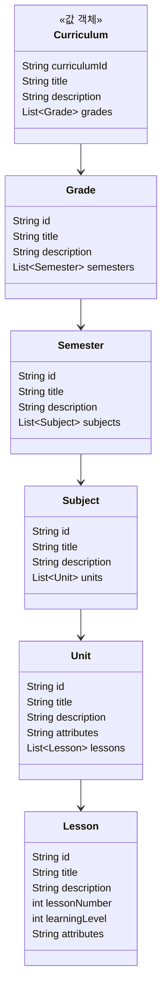

- domain-core `valueobject`에 둔다. 원본과 배포가 함께 쓰는 모델이고, 프레임워크를 모른다.
- 모두 `record`이고 목록은 `List.copyOf`로 복사해 둔다. 만든 뒤 바뀌지 않는다.
- 만들 때 `curriculumId`와 `title`이 비어 있지 않은지 검사한다. 원본 문서의 칸 검사는 지금처럼 변환기가 한다. 변환기는 "문서에 칸이 있나"를, `Curriculum`은 "커리큘럼으로서 말이 되나"를 본다.

**`Subject`, `Unit`, `Lesson`은 `Curriculum` 쪽으로 옮긴다.** 지금은 `ChunkContent` 안에 있다. 과목 청크는 "과목 하나와 그 아래 전부"라서 이 셋을 그대로 쓴다. 그렇다면 청크가 커리큘럼을 가리켜야지, 커리큘럼이 청크의 타입을 빌려 쓰면 안 된다. 청크는 커리큘럼을 나눈 결과이기 때문이다. `Grade`와 `Semester`는 둘 다 두되 모양이 다르다. 커리큘럼의 학기는 과목 목록을 가지고, 뼈대의 학기는 과목 ID 목록만 가진다.

| 타입 | 지금 | 바꾼 뒤 |
|---|---|---|
| `Subject`, `Unit`, `Lesson` | `ChunkContent.Subject` … | `Curriculum.Subject` …. `SubjectChunk`가 `Curriculum.Subject`를 담는다 |
| `Grade`, `Semester` (과목까지 있는 것) | 없다 | `Curriculum.Grade`, `Curriculum.Semester` |
| `Grade`, `Semester` (과목 ID만 있는 것) | `ChunkContent.Grade`, `ChunkContent.Semester` | 그대로 |

메시지 계약(Avro)은 바뀌지 않는다. 메시징 매퍼의 import만 바뀐다.

### 7.6 청크로 나누기

```java
// domain-core, ChunkContent 안
static List<ChunkContent> split(Curriculum curriculum)
```

- 0번은 `Skeleton`이다. 학기까지와 학기별 과목 ID 목록을 담는다.
- 1번부터는 `SubjectChunk`다. 학년과 학기 순서대로, 과목 하나에 하나씩이다.
- 돌려주는 목록은 바꿀 수 없다. 과목 수는 `size() - 1`이다.
- 나누는 규칙이 청크 타입 바로 옆에 있어서, 청크 모양을 바꿀 때 한곳만 보면 된다. 원본 칸 이름은 모른다.

전에는 `CurriculumSourceConverter`의 `toSkeleton`, `toSubjectChunks`가 하던 일이다. 변환기에는 `toCurriculum` 하나만 남았다.

### 7.7 바뀐 곳

| 곳 | 전 | 후 |
|---|---|---|
| `SourceRepository.findData` | `Optional<SourceContentData>` | `Optional<SourceDocument>` |
| `CurriculumSourceConverter` | `toCurriculumId`, `toSkeleton`, `toSubjectChunks` | `toCurriculum(JsonNode)` 하나 |
| `DeploymentDataConvertHelper` | JSON을 읽고 청크를 돌려주며, 인자를 고친다 | `toCurriculum(SourceDocument)`가 `Curriculum`을 돌려준다. 인자는 건드리지 않는다 |
| `SourceFindDataHandler` | 원본 설정을 찾고, 문서를 꺼내고, 청크로 나눠 `SourceContentData`를 돌려준다 | `findCurriculum(SourceId, SourceConfig)`가 문서를 꺼내 `Curriculum`을 돌려준다 |
| `DeploymentApplicationServiceImpl` | 핸들러 하나를 부른다 | 원본 설정 찾기 → `findCurriculum` → `sendData(deployment, sourceConfig, curriculum)` |
| `ChunkContent` | 나누는 일은 밖에 있다 | `split(Curriculum)`을 가진다 |
| `DeploymentDomainServiceImpl` | `SourceContentData`에서 청크 목록을 꺼낸다 | `(Deployment, SourceConfig, Curriculum)`을 받아 직접 나눈다 |
| `Deployment` | `sourceContentData` 칸 | 칸을 지웠다. `initializeDeployment(sourceType, dbType, 청크 수)` |
| `DeploymentRequestEvent` | 커리큘럼 ID는 `Deployment.sourceContentData`에서 읽었다 | `curriculumId` 칸을 가진다 |
| `DeploymentDataAccessMapper`, `DeploymentRepositoryImpl` | `totalChunkSize`에 늘 0인 `chunkOffset`을 넣었다 | 청크 수를 넣는다 |
| 결과 처리(`DeploymentDataMapper`) | 결과의 청크 번호를 `SourceContentData`에 담았다. 읽는 곳은 없었다 | 그 줄을 지웠다 |
| `SourceContentData` | | 지웠다 |

처음 계획과 다르게 한 것이 셋 있다.

| 계획 | 실제 | 이유 |
|---|---|---|
| 커리큘럼 ID를 `Deployment`가 받는다 | 청크 이벤트(`DeploymentRequestEvent`)에 싣는다 | 배포 표에 커리큘럼 ID 칸이 없다. `Deployment`에만 두면 DB에서 되살린 배포는 그 값이 늘 빈다. 저장은 [도메인 모델](../domain/model.md#6-값-객체)의 `CurriculumRef` 작업 때 마이그레이션과 함께 한다 |
| `Deployment`는 커리큘럼 ID와 청크 수만 받는다 | `sourceType`, `dbType`도 칸으로 가진다 | 배포 표의 두 칸이 `NOT NULL`이다. 전에는 `SourceContentData`가 대신 들고 있었다 |
| 원본 설정은 핸들러 안에서 찾는다 | 애플리케이션 서비스가 찾는다 | 배포 쪽이 원본 설정(위 줄)을 써야 해서, 핸들러가 설정과 커리큘럼을 함께 돌려주는 모양을 피했다. 대신 배포 쪽이 `SourceConfig`를 더 본다. 7.9절에서 푼다 |

### 7.8 순서

모두 했다. 단계마다 빌드와 테스트가 통과한 상태로 커밋했다.

1. 이 장을 썼다.
2. `Curriculum`을 만들고 JUnit으로 테스트했다(`CurriculumTest`). `Subject`, `Unit`, `Lesson`을 옮겼다.
3. `ChunkContent.split`을 만들고 테스트했다(`ChunkContentTest`).
4. 변환기가 `Curriculum`을 돌려주게 했다. `SourceDocument`를 만들고 포트와 어댑터를 바꿨다.
5. 접수 흐름에서 `SourceContentData`를 걷어내고 지웠다.
6. 0~6장과 8장을 바뀐 코드에 맞게 고쳤다.

### 7.9 이번에 하지 않는 것

- **`SourceConfig`를 원본 뒤로 숨기기.** 지금은 배포의 애플리케이션 계층이 `SourceConfig`를 직접 꺼낸다. 비밀번호가 든 객체가 배포 쪽까지 온다. 컨텍스트 맵대로라면 배포는 "원본 저장소 ID와 문서 ID를 주면 `Curriculum`을 준다"는 포트 하나만 알아야 한다. 범위가 커서 따로 한다.
- **`SourceConfig`의 ID가 비어 있는 것.** `SourceDataAccessMapper.entityToSourceConfig`가 `id`를 옮기지 않는다. 위 작업 때 함께 고친다.

## 8. 모듈 지도

| 모듈 | 이 흐름의 클래스 | 역할 |
|---|---|---|
| `deployment-application` | `DeploymentController`, `DeploymentGlobalExceptionHandler` | REST 입구, 예외를 응답으로 |
| `deployment-application-service` | `DeploymentApplicationServiceImpl`, `SourceFindDataHandler`, `SourceConfigHelper`, `SourceFindHelper`, `DeploymentDataConvertHelper`, `CurriculumSourceConverter`, 포트 `SourceConfigRepository`, `SourceRepository`와 `SourceDocument` | 유스케이스 조율, 원본 문서 해석 |
| `deployment-domain-core` | `SourceConfig`, `Curriculum`, `ChunkContent`(`split`), `DeploymentDomainServiceImpl`, `SourceType`, `DbType`, `CurriculumBaseKey` | 프레임워크 없는 모델. 청크로 나누는 규칙도 여기 있다 |
| `deployment-dataaccess` | `SourceConfigRepositoryImpl`, `SourceRepositoryImpl`, `DynamicDataSourceConnector`, `MongoConnectHelper`, `MysqlConnectHelper`, `SourceDataAccessMapper` | 포트 구현, 원본 DB 접속 |

application-service는 포트(`SourceRepository`)만 알고, Mongo와 MySQL은 dataaccess 안에만 있다. 원본 칸 이름은 application-service의 `CurriculumSourceConverter`만 알고, 청크로 나누는 규칙은 domain-core의 `ChunkContent.split`만 안다.
