# 원본을 읽어 청크로 나누는 흐름

> 배포를 접수할 때 **원본 저장소에서 커리큘럼 문서 하나를 꺼내 청크 목록으로 바꾸기까지**를 다룬다.
> 청크를 저장하고 아웃박스에 넣는 뒤쪽 일은 다루지 않는다([시스템 설계 2장](architecture.md#2-처리-흐름과-트랜잭션)).
> 2026-11-11 코드 기준이다. 클래스 이름은 코드 그대로 적었다.

## 0. 한눈에

네 부분으로 나뉜다. 각 부분은 아래 장에서 따로 본다.

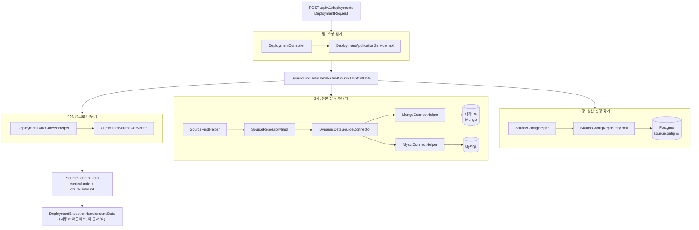

`SourceFindDataHandler`가 2, 3, 4장을 차례로 부르는 조율자다.

```java
SourceConfig sourceConfig = sourceConfigHelper.findSourceConfigInfo(sourceConfigId);          // 2장
SourceContentData data = sourceFindHelper.findSourceContentData(sourceId, sourceConfig);      // 3장
List<ChunkContent> chunks = deploymentDataConvertHelper.splitCurriculumJsonIntoChunks(data);  // 4장
data.updateChunkDataList(chunks);
```

### 객체가 바뀌는 순서

같은 데이터가 단계마다 어떤 모양이 되는지 먼저 본다.

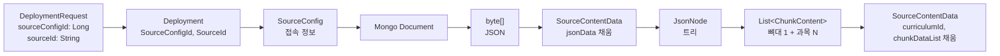

| 단계 | 객체 | 있는 모듈 | 누가 만드나 |
|---|---|---|---|
| 요청 | `DeploymentRequest` | application-service (`dto/create`) | Spring이 JSON 본문으로 만든다 |
| 배포 | `Deployment` | domain-core | `DeploymentDataMapper` |
| 원본 설정 | `SourceConfigEntity` → `SourceConfig` | dataaccess → domain-core | JPA, `SourceDataAccessMapper` |
| 원본 문서 | `Document` → `byte[]` | dataaccess | Mongo 드라이버, `MongoConnectHelper.toJson` |
| 원본 데이터 | `SourceContentData` | domain-core | `SourceDataAccessMapper` |
| 파싱한 트리 | `JsonNode` | application-service 안에서만 | `ObjectMapper.readTree` |
| 청크 내용 | `ChunkContent` | domain-core | `CurriculumSourceConverter` |

## 1. 요청 받기

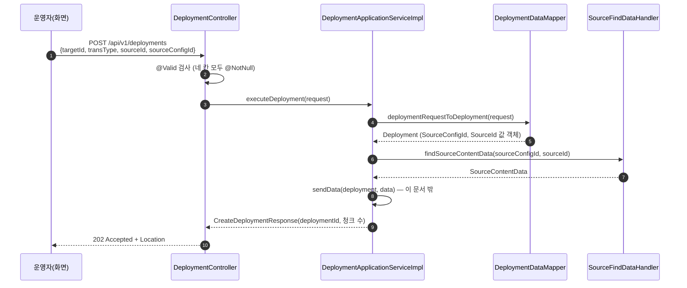

요청 본문에서 이 문서에 관계있는 칸은 둘이다.

| 칸 | 뜻 | 예 |
|---|---|---|
| `sourceConfigId` | **어느 원본 저장소**에서 읽을지. `sourceconfig` 표의 키 | `1` |
| `sourceId` | 그 저장소 안의 **어느 문서**인지. Mongo면 `_id`(24자리 16진수) | `"6731a2b4c5d6e7f801234567"` |

이름이 비슷해서 헷갈린다. `sourceConfigId`는 "어디서", `sourceId`는 "무엇을"이다([용어집](../domain/glossary.md)의 원본 저장소).

## 2. 원본 설정 찾기

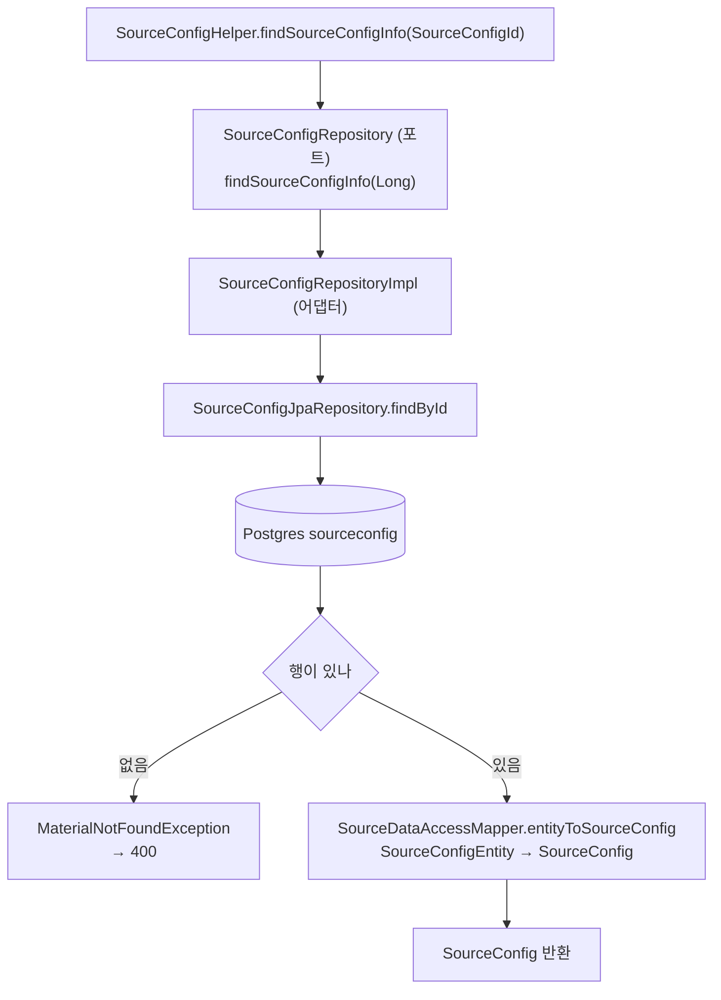

`SourceConfig`는 접속 정보 묶음이다. 표의 칸이 그대로 옮겨진다.

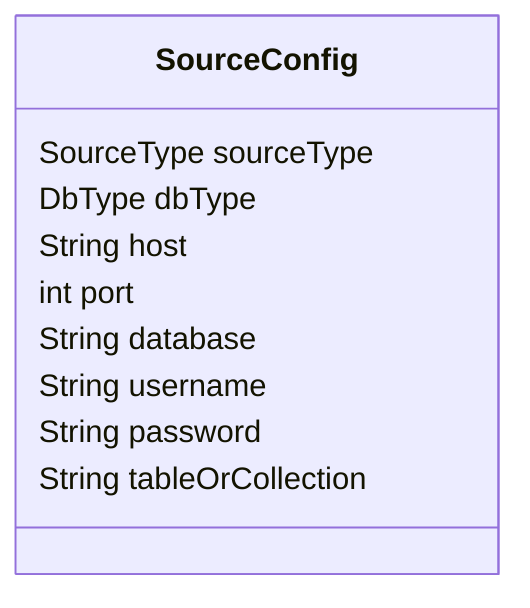

| 칸 | 값 | 쓰는 곳 |
|---|---|---|
| `sourceType` | `CURRICULUM`, `EXAM_RESULT_DATA` | 4장. 커리큘럼으로 나눌지 정한다 |
| `dbType` | `MONGO`, `MYSQL`, `POSTGRESQL`, `ORACLE`, `H2` | 3장. 어느 헬퍼로 읽을지 정한다 |
| `host`, `port`, `database`, `username`, `password` | 접속 정보 | 3장. 연결 풀을 만든다 |
| `tableOrCollection` | Mongo면 컬렉션, MySQL이면 표 이름 | 3장. 조회 대상 |

## 3. 원본 문서 꺼내기

### 3.1 호출 순서

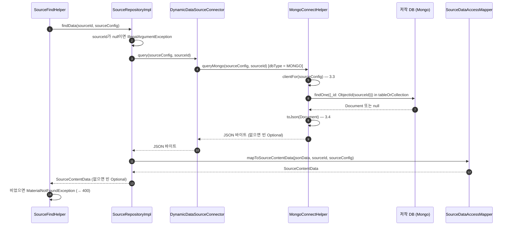

### 3.2 DB 종류로 길이 갈린다

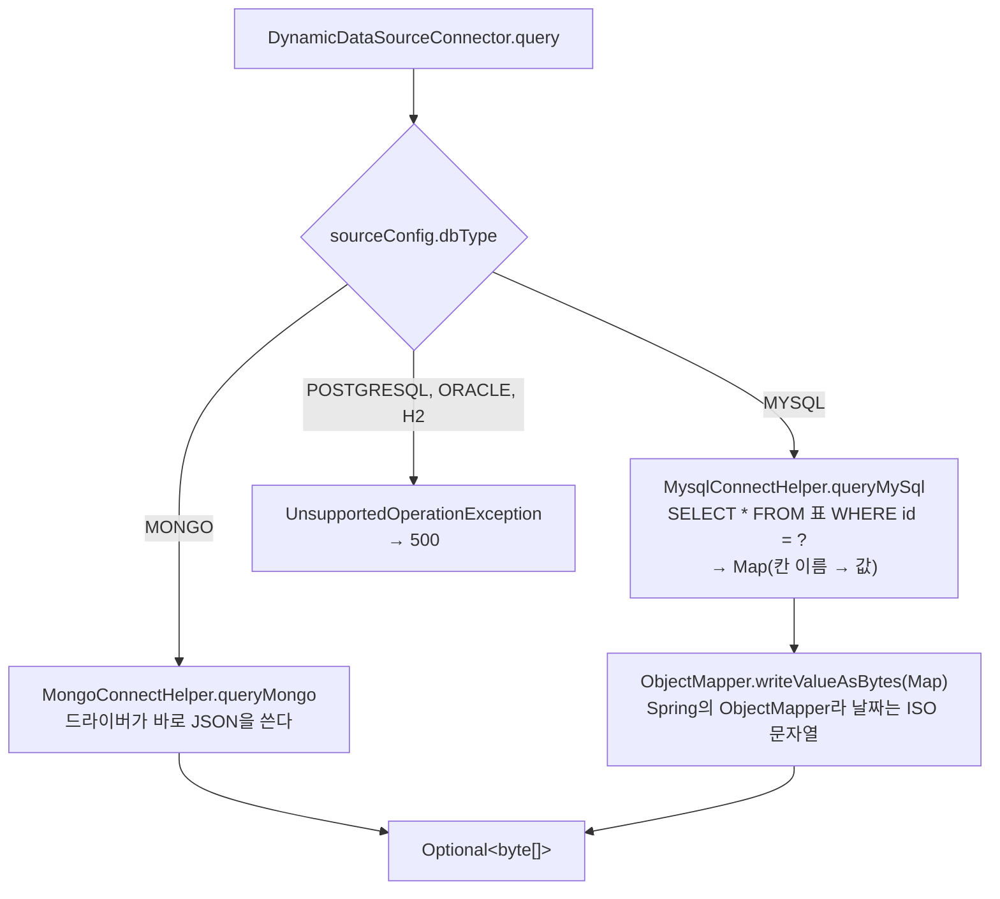

어느 길로 와도 결과는 **JSON 바이트**다. 원본마다 JSON을 만드는 방법이 달라서 여기서 통일한다.

경계를 `JsonNode`나 `Document`가 아니라 `byte[]`로 둔 이유: `SourceContentData`는 domain-core에 있고, domain-core는 Jackson도 BSON도 모른다.

### 3.3 연결 풀은 원본 설정마다 하나

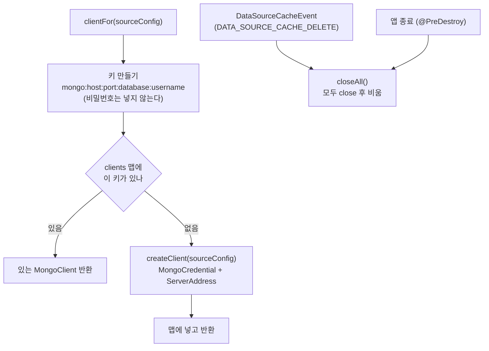

- "있나 보고, 없으면 만들어 넣기"를 `ConcurrentHashMap.computeIfAbsent` 한 번으로 한다. 같은 키로 동시에 와도 풀은 하나만 생긴다.
- MySQL(`MysqlConnectHelper`)도 같은 모양이다. 키는 `datasource:dbType:host:port:database`이고, 값은 `HikariDataSource`다.
- 캐시를 비우는 이벤트는 받는 쪽만 있다. **보내는 곳은 아직 없다.** 원본 설정을 고치는 기능이 생기면 그곳에서 보낸다.

### 3.4 Mongo 문서를 JSON으로 바꾸는 규칙

`MongoConnectHelper.JSON_SETTINGS`가 정한다. 대상이 Mongo 전용 모양을 몰라도 되게 하려는 것이다([ADR 0006](../adr/0006-chunk-content-contract.md)).

| Mongo 값 | JSON | 예 |
|---|---|---|
| `ObjectId` | 16진 문자열 | `"6731a2b4c5d6e7f801234567"` |
| `Date` | ISO-8601 UTC 문자열 | `"2026-11-11T00:00:00Z"` |
| `Int32`, `Int64`, `Double` | 숫자 그대로 (RELAXED 모드) | `3` |
| 문자열, 배열, 문서 | 그대로 | |

### 3.5 이 단계가 끝나면

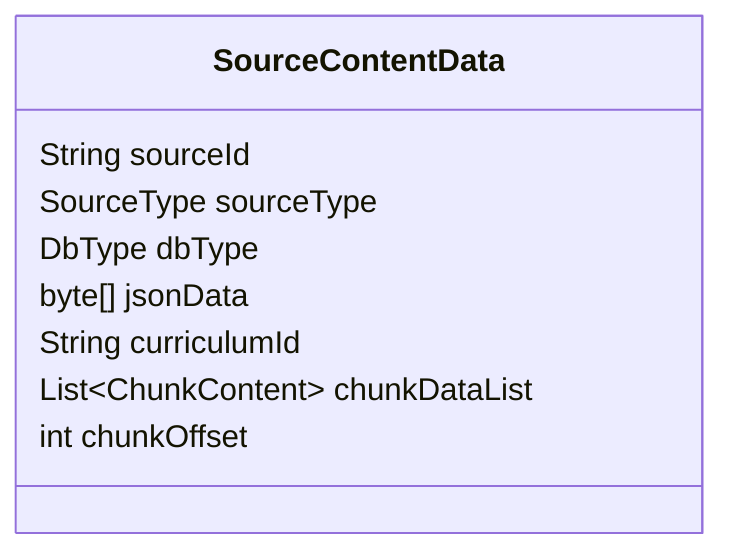

| 칸 | 3장이 끝난 뒤 | 채우는 곳 |
|---|---|---|
| `sourceId` | 채움 | 요청의 `sourceId` |
| `sourceType`, `dbType` | 채움 | 원본 설정 |
| `jsonData` | 채움 | 원본 문서 JSON |
| `curriculumId` | 비어 있음 | 4장 `toCurriculumId` |
| `chunkDataList` | 비어 있음 | 4장 결과를 `SourceFindDataHandler`가 넣는다 |
| `chunkOffset` | 쓰지 않음 | 결과 처리 쪽의 옛 코드가 쓴다 |

## 4. 청크로 나누기

### 4.1 원본 문서의 모양

저작 DB의 문서 하나가 커리큘럼 하나다. 칸 이름은 `CurriculumBaseKey`에 있다.

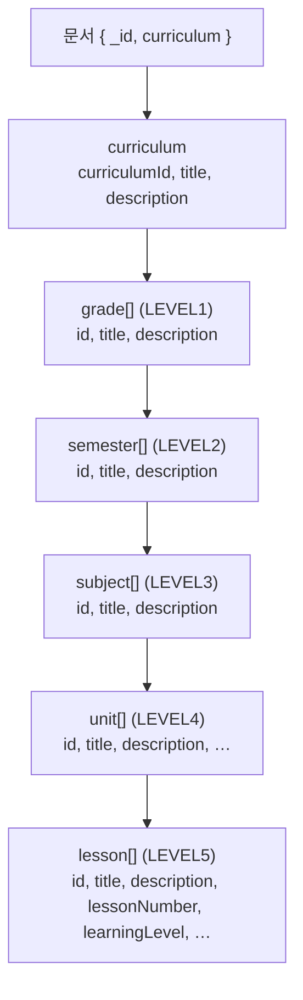

예(줄였다):

```json
{
  "_id": "6731a2b4c5d6e7f801234567",
  "curriculum": {
    "curriculumId": "CUR001", "title": "중등", "description": "중등 과정",
    "grade": [{
      "id": "G1", "title": "1학년",
      "semester": [{
        "id": "S1", "title": "1학기",
        "subject": [
          { "id": "SUB1", "title": "국어",
            "unit": [{ "id": "U1", "title": "단원 1",
              "lesson": [{ "id": "L1", "title": "차시 1", "lessonNumber": 1, "learningLevel": 3, "format": "Video" }] }] },
          { "id": "SUB2", "title": "수학", "unit": [] }
        ]
      }]
    }]
  }
}
```

### 4.2 나누는 순서

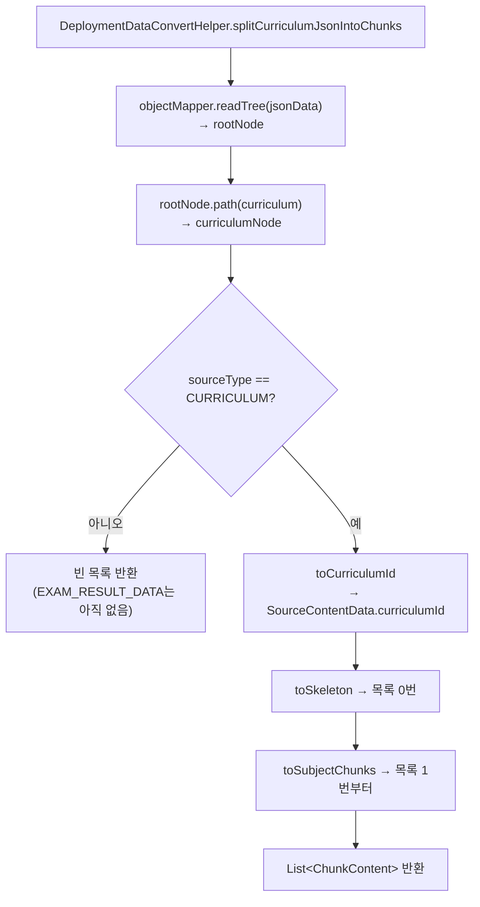

`SourceFindDataHandler`가 이 목록을 `SourceContentData.chunkDataList`에 넣는다. 목록의 순서가 곧 청크 번호다.

### 4.3 문서 하나가 청크 여러 개가 된다

위 예의 문서는 청크 셋이 된다.

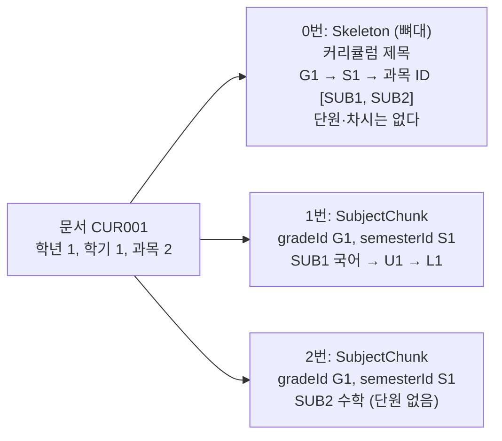

- **뼈대(0번)**는 학기까지와 학기별 과목 ID 목록만 담는다. 대상은 이 목록에 없는 과목을 서비스에서 뺀다([이벤트와 메시지 6절](../domain/events.md#6-원본에서-지운-과목은-대상에서도-뺀다)).
- **과목 청크(1번부터)**는 과목 하나와 그 아래 단원, 차시 전부를 담는다. 어느 학년, 학기의 과목인지도 함께 담는다.
- 과목 청크 수는 문서 전체의 과목 수다. 시드 문서(학년 4 × 학기 2 × 과목 5)라면 뼈대 1 + 과목 40 = 청크 41개다.

### 4.4 만들어지는 객체

`ChunkContent`(domain-core)는 sealed interface이고, 청크는 `Skeleton`이나 `SubjectChunk` 둘 중 하나다.

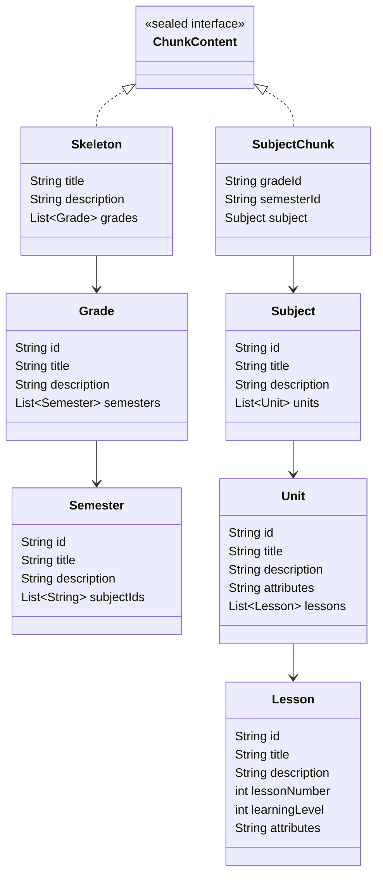

### 4.5 어느 칸이 어디로 가나

| 원본 칸 | 필수? | 어디로 |
|---|---|---|
| `curriculum.curriculumId` | 필수 | `SourceContentData.curriculumId` (청크 안에는 없다) |
| 모든 단계의 `id`, `title` | 필수 | 같은 이름의 칸 |
| 모든 단계의 `description` | 없어도 됨 | 같은 이름의 칸, 없으면 `null` |
| 차시 `lessonNumber` | 필수 (정수) | `Lesson.lessonNumber` |
| 차시 `learningLevel` | 필수 (정수) | `Lesson.learningLevel`과 `Lesson.attributes` 둘 다. 받는 쪽이 옮겨 가면 `attributes`에만 남는다 |
| 단원, 차시의 **나머지 칸 전부** | 검사 안 함 | `attributes` (JSON 객체 문자열, 원본 순서 그대로) |
| 학년, 학기, 과목의 나머지 칸 | | 버린다 |
| 문서의 `_id` | | 버린다 (`sourceId`로 이미 안다) |

위 예의 차시 `L1`은 이렇게 된다.

```text
Lesson(id="L1", title="차시 1", description=null, lessonNumber=1, learningLevel=3,
       attributes="{\"learningLevel\":3,\"format\":\"Video\"}")
```

단원 `U1`은 아는 칸과 `lesson` 말고는 칸이 없어서 `attributes="{}"`다.

### 4.6 검사

원본 칸 이름을 아는 곳은 `CurriculumSourceConverter` 한 곳뿐이다. 검사도 여기서 한다.

| 메서드 | 하는 일 | 실패하면 |
|---|---|---|
| `requiredText(node, 칸)` | 문자열이 있어야 한다 | `IllegalArgumentException("저작 문서에 문자열 필드 'title' 가 없습니다: id=L1")` |
| `requiredInt(node, 칸)` | 정수가 있어야 한다 | 같은 모양, "정수 필드" |
| `optionalText(node, 칸)` | 문자열이면 값, 아니면 `null` | 실패하지 않는다 |

오류 메시지에는 문서 전체가 아니라 그 노드의 `id`만 넣는다. 문서가 커서다.

## 5. 실패하면

| 어디서 | 상황 | 예외 | 응답 |
|---|---|---|---|
| 1장 | 요청 칸이 비었다 | `MethodArgumentNotValidException` | 400, 어느 칸인지 |
| 2장 | `sourceConfigId`에 맞는 설정이 없다 | `MaterialNotFoundException` | 400 |
| 3장 | `sourceId`가 ObjectId 모양(24자리 16진수)이 아니다 | `IllegalArgumentException` | 500 |
| 3장 | 지원하지 않는 DB 종류다 | `UnsupportedOperationException` | 500 |
| 3장 | Mongo에 붙지 못한다 | `MongoTimeoutException` (서버 선택 30초 뒤) | 500 |
| 3장 | 문서가 없다 | `MaterialNotFoundException` | 400 |
| 4장 | 필수 칸이 없거나 타입이 다르다 | `IllegalArgumentException`을 `RuntimeException`으로 감쌈 | 500 |

500은 공통 처리기(`GlobalExceptionHandler`)가 `"Unexpected error!"`로 돌려준다. 그래서 운영자는 무엇이 잘못됐는지 알 수 없다. 아래 6장에 적었다.

## 6. 지금 남은 문제

| # | 문제 | 고칠 방향 |
|---|---|---|
| 1 | 4장의 필수 칸 오류가 500이 된다. `DeploymentDataConvertHelper`가 모든 예외를 `RuntimeException`으로 감싸기 때문이다 | 감싸지 않거나 원본 문서 오류용 예외를 두고 422로 돌려준다. 어느 차시의 어느 칸인지 운영자가 봐야 한다 |
| 2 | `sourceId`가 ObjectId 모양이 아니면 500이 된다 | 400으로 돌려준다 |
| 3 | 원본 설정이 없을 때 메시지가 "Not found sourceContentData"다 | "원본 저장소가 없다"로 고친다 |
| 4 | MySQL 원본은 행 하나를 평평한 Map으로 읽는다. 변환기는 `curriculum` 아래 트리를 기대하므로 MySQL 원본으로는 커리큘럼을 나눌 수 없다 | MySQL 원본을 계속 둘지 정한다. 둔다면 행을 트리로 바꾸는 방법이 따로 있어야 한다 |
| 5 | `sourceType`이 `EXAM_RESULT_DATA`면 오류 없이 청크 0개가 된다 | 지원하지 않는다고 거절한다 |
| 6 | `SourceContentData`가 원본 JSON(`jsonData`)을 청크로 나눈 뒤에도 들고 다닌다 | 나눈 뒤에는 필요 없다. 접수 단계를 새 모델에 이을 때 함께 정리한다 |
| 7 | 캐시를 비우는 `DataSourceCacheEvent`를 보내는 곳이 없다 | 원본 설정 수정 기능을 만들 때 보낸다 |

## 7. 모듈 지도

| 모듈 | 이 흐름의 클래스 | 역할 |
|---|---|---|
| `deployment-application` | `DeploymentController`, `DeploymentGlobalExceptionHandler` | REST 입구, 예외를 응답으로 |
| `deployment-application-service` | `DeploymentApplicationServiceImpl`, `SourceFindDataHandler`, `SourceConfigHelper`, `SourceFindHelper`, `DeploymentDataConvertHelper`, `CurriculumSourceConverter`, 포트 `SourceConfigRepository`, `SourceRepository` | 유스케이스 조율, 원본 문서 해석 |
| `deployment-domain-core` | `SourceConfig`, `SourceContentData`, `ChunkContent`, `SourceType`, `DbType`, `CurriculumBaseKey` | 프레임워크 없는 모델 |
| `deployment-dataaccess` | `SourceConfigRepositoryImpl`, `SourceRepositoryImpl`, `DynamicDataSourceConnector`, `MongoConnectHelper`, `MysqlConnectHelper`, `SourceDataAccessMapper` | 포트 구현, 원본 DB 접속 |

application-service는 포트(`SourceRepository`)만 알고, Mongo와 MySQL은 dataaccess 안에만 있다. 원본 칸 이름은 application-service의 `CurriculumSourceConverter`만 안다.
