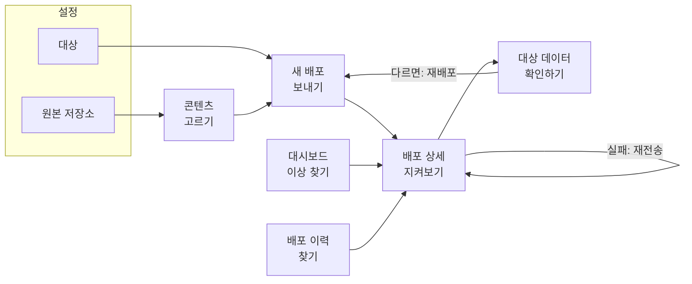

# 화면 설계

> 콘텐츠 배포 콘솔(`deployment-console`)의 **설계 의도**를 적는다. 어떤 일을 어떤 흐름으로 하게 했고, 왜 그렇게 만들었는지가 내용이다.
> 와이어프레임과 필요한 API는 [화면 기획](../console-plan.md)에 있다. 용어는 [용어집](../domain/glossary.md), 상태는 [도메인 모델](../domain/model.md)을 따른다.
> 지금 화면은 모의 데이터로 돈다. 사용성 테스트는 하지 않았고, 이 문서의 판단은 설계자의 근거다.

## 1. 누가 무엇을 하는가

사용자는 **콘텐츠 운영자**다. 개발자가 아니고, 커리큘럼을 서비스에 내보내는 사람이다. 이 사실에서 화면의 방향이 나온다.

| 운영자가 알고 싶은 것 | 운영자가 몰라도 되는 것 |
|---|---|
| 내가 보낸 커리큘럼이 서비스에 들어갔나 | Kafka, 파티션, 아웃박스 |
| 안 들어갔다면 어느 과목이 왜 안 들어갔나 | 청크 번호가 어떻게 매겨지는지 |
| 내가 지금 하려는 일이 위험한가 | 대상 쪽에서 누가 반영하는지 |

사가 시연 화면으로 시작했던 것을 이 기준으로 다시 만들었다. 처리 단계를 보여 주는 대신 **운영자의 일이 끝났는지**를 보여 준다.

## 2. 전체 흐름

| 화면 | 경로 | 답하는 질문 |
|---|---|---|
| 대시보드 | `/` | 지금 손봐야 할 것이 있나? |
| 콘텐츠 | `/contents` | 무엇을 보낼 수 있고, 어디까지 나가 있나? |
| 새 배포 | `/deployments/new` | 이것을 여기로 보내도 되나? |
| 배포 이력 | `/deployments` | 그때 그 배포가 어떻게 됐나? |
| 배포 상세 | `/deployments/:id` | 끝났나? 무엇이 왜 실패했나? |
| 대상 데이터 확인 | `/targets/:targetId/curriculums/:curriculumId` | 원본과 같은가? |
| 원본 저장소 | `/settings/sources` | 어디서 읽어 오나? 연결돼 있나? |
| 대상 | `/settings/targets` | 어디로 보낼 수 있나? 상태는 어떤가? |

메뉴는 자주 하는 일(대시보드, 콘텐츠, 배포 이력)과 가끔 하는 일(설정)로 나눴다. 새 배포 버튼은 상단에 고정해 어디서든 시작할 수 있다.

## 3. 설계 원칙

| 원칙 | 화면에서 | 고르지 않은 것 |
|---|---|---|
| **운영자의 말로 보여 준다** | 청크를 번호가 아니라 "중등 1학년 1학기 영어"로 보여 준다. 내부 상태 다섯 개를 묶어 보여 준다 | 내부 상태와 청크 번호를 그대로 노출하기. 정확하지만 운영자가 판단할 수 없다 |
| **위험할수록 멈춰 세운다** | 운영 환경은 확인 체크를 해야 보낼 수 있다. 개발 환경은 체크 없이 보낸다 | 모든 배포에 확인 창 띄우기. 자주 보면 읽지 않고 누르게 된다 |
| **막을 때는 이유와 다음 행동을 함께 준다** | 진행 중인 대상은 "진행 중인 배포 보기" 링크와 함께 비활성화한다 | 버튼만 끄기. 왜 안 되는지 알 수 없다 |
| **문제를 먼저 보여 준다** | 대시보드 첫 목록이 "확인이 필요한 배포"다 | 지표와 차트 위주의 대시보드. 보기 좋지만 할 일을 알려 주지 않는다 |
| **규칙의 주인은 서버다** | 화면은 미리 막아 줄 뿐이고, 같은 규칙을 서버가 다시 지킨다(409, 422). 서버가 거절하면 그 사유를 보여 준다 | 화면 검사만 믿기. 두 사람이 동시에 누르면 뚫린다 |
| **상태는 주소에 둔다** | 필터, 검색어, 페이지, 고른 커리큘럼이 URL에 있다. 새로고침해도 유지되고 주소를 동료에게 보낼 수 있다 | 화면 메모리에만 두기. 코드는 짧지만 뒤로 가기와 공유가 깨진다 |
| **일이 끊기지 않게 잇는다** | 콘텐츠의 [배포하기], 상세의 [다시 배포]는 값을 채운 채 새 배포를 연다. ID를 외워 입력할 일이 없다 | 메뉴로 돌아가 다시 고르기 |
| **데이터의 네 상태를 모두 그린다** | 모든 조회에 불러오는 중, 비어 있음, 오류(다시 시도), 정상을 만들었다. 비어 있을 때는 다음 행동을 안내한다 | 정상 화면만 만들기. 운영 화면은 문제가 있을 때 더 많이 본다 |

## 4. 화면별 결정

### 대시보드
- **"확인이 필요한 배포"의 기준은 실패 전체가 아니다.** 커리큘럼 × 대상마다 가장 최근 배포만 보고, 그것이 실패일 때만 넣는다. 이미 다시 보내 성공한 실패까지 보여 주면 목록이 쌓여 아무도 보지 않게 된다.
- **갱신**: 진행 중인 배포가 있을 때만 짧은 주기로 다시 읽고, 없으면 느리게 읽는다.

### 콘텐츠
- **목록과 상세를 한 화면에 나란히 둔다.** 여러 커리큘럼을 차례로 살펴보는 일이 많으므로 화면을 오가지 않게 했다.
- **트리는 과목까지만 펼친다.** 단원과 차시는 수만 보여 준다. 차시가 수천 개라 펼쳐도 운영자가 읽을 수 없다. 과목이 배포의 단위이기도 하다.
- **대상별 배포 현황을 함께 보여 준다.** "무엇이 있나"와 "어디까지 나갔나"는 같은 판단에 쓰인다.

### 새 배포
- **단계를 나누지 않고 한 화면에 둔다.** 입력이 커리큘럼과 대상 둘뿐이라 마법사 형태는 클릭만 늘린다. 오른쪽의 확인 카드가 고른 내용을 계속 보여 준다.
- **대상은 하나만 고른다.** 배포 하나의 대상은 하나다([모델](../domain/model.md#2-애그리거트)). 두 곳에 보내려면 배포를 두 번 한다. 라디오 버튼이 이 규칙을 그대로 드러낸다.
- **대상 옆에 이 커리큘럼의 배포 기록을 보여 준다.** "이미 배포됨 → 덮어씀"을 고르기 전에 알 수 있다.

### 배포 이력
- **표로 만든다.** 여러 조건으로 찾고 비교하는 화면이라 카드보다 표가 낫다. 행 전체를 눌러 상세로 간다.
- **상태 탭에 건수를 붙인다.** 눌러 보기 전에 어디에 무엇이 있는지 안다.

### 배포 상세
이 콘솔의 중심 화면이다.

- **청크를 칸으로 보여 준다.** 진행률 막대만으로는 "41개 중 3개 실패"를 알 수 있어도 어느 것인지 알 수 없다. 칸은 흩어진 실패와 "뼈대에서 멈춤"을 한눈에 구별해 준다. 뼈대(0번)는 테두리로 구별한다.
- **칸을 눌러야 자세히 보이고, 실패한 것만 따로 목록으로 펼친다.** 성공한 40개는 읽을 이유가 없다.
- **재전송과 재배포를 다른 버튼으로 나눈다.** 뜻이 다르다. 재전송은 같은 내용을 같은 배포에서 다시 보내고, 재배포는 원본을 다시 읽어 새 배포를 만든다([용어집](../domain/glossary.md#재전송-retry)).
- **끝난 뒤의 다음 행동을 제시한다.** 완료되면 대상 데이터 확인으로 이끈다. 배포가 완료됐다는 것과 원본과 같다는 것은 다른 사실이다([모델](../domain/model.md#6-값-객체)).

### 대상 데이터 확인
- **기본으로 차이만 보여 준다.** 차이가 없을 때만 전체를 펼쳐 둔다. 과목 40개 중 다른 1개를 찾으러 온 화면이기 때문이다.
- **개수 비교와 과목 비교를 함께 둔다.** 개수로 규모를 보고, 과목으로 어디인지 본다.
- **차이 종류를 색과 글자로 함께 표시한다.** 없음, 변경됨, 원본에 없음은 대응이 다르다.
- **차이가 있으면 [다시 배포]를 주 버튼으로 올린다.** 같으면 보조 버튼으로 낮춘다.

### 원본 저장소
- **저장과 연결 테스트를 한 버튼으로 묶는다.** 저장해 놓고 테스트를 잊는 일을 없앴다. 기획은 버튼 둘이었지만 만들어 보니 둘로 나눌 이유가 없었다.
- **테스트에 실패해도 저장은 유지한다.** 저작 DB가 잠시 내려가 있어도 설정을 잃지 않게 했다. 대신 경고를 남긴다.
- **입력한 값을 끝까지 지킨다.** 다시 저장해도 새로 생기지 않고 고쳐진다. 비밀번호는 다시 보여 주지 않고, 비워 두면 기존 값을 쓴다.

### 대상
- **추가와 삭제가 없다.** 대상은 시스템 × 환경으로 정해진 목록이다. 운영자가 바꾸는 것은 배포 허용뿐이다.
- **배포 허용을 끌 때만 확인을 받는다.** 끄는 쪽이 다른 사람의 일을 막기 때문이다. 진행 중인 배포는 멈추지 않는다고 알려 준다.

## 5. 도메인 상태를 화면에 옮기는 법

모델을 구현한 뒤의 기준이다. [모델](../domain/model.md#4-상태-기계)의 상태와 일대일로 맞춘다.

### 배포

| 상태 | 표시 | 운영자에게 주는 행동 |
|---|---|---|
| `IN_PROGRESS` | 진행 중 (파랑) | 지켜본다. 재전송과 재배포를 막는다 |
| `SUCCEEDED` | 완료 (초록) | 대상 데이터 확인, 다시 배포 |
| `FAILED` | 실패 (빨강) | 재전송, 다시 배포, 대상 데이터 확인 |

### 청크

| 상태 | 칸 | 상세의 문구 |
|---|---|---|
| `WAITING` | 회색 | 보내기 전 |
| `SENT`, 시도 1 | 파랑 | 응답 기다리는 중 |
| `SENT`, 시도 2 이상 | 파랑, 깜박임 | 재전송 중 (시도 N) |
| `APPLIED` | 초록 | 반영됨 |
| `FAILED` + `REJECTED` | 빨강 ✕ | 대상이 거절함 + 대상이 보낸 사유 |
| `FAILED` + `NO_REPLY` | 빨강 ? | 기한 안에 응답 없음. 반영됐을 수도 있다 |

**`REJECTED`와 `NO_REPLY`는 구별해서 보여 준다.** 뜻이 다르다. 거절은 대상이 안 했다고 알린 것이고, 응답 없음은 **됐는지 모르는 것**이다. 이때 "실패"라고만 하면 운영자가 들어가지 않았다고 잘못 믿는다. 늦게 성공 결과가 오면 스스로 `APPLIED`로 바뀐다는 것도 함께 적는다.

**뼈대가 실패한 배포는 원인을 하나로 말한다.** 과목은 나가지 않았고 `WAITING`으로 남는다([불변식 3](../domain/model.md#3-불변식)). "뼈대가 실패해 과목 40개를 보내지 않았습니다"라고 적어, 과목 40개를 따로따로 살펴보지 않게 한다.

### 서버의 거절

| 응답 | 언제 | 화면 |
|---|---|---|
| 409 | 같은 커리큘럼 × 대상으로 진행 중 | 진행 중인 배포로 가는 링크 |
| 409 | 더 최근 배포가 있는 배포를 재전송 | 재전송 대신 최근 배포로 가는 링크와 재배포 안내 |
| 422 | 배포 허용이 꺼진 대상 | 대상 설정으로 가는 링크 |

## 6. 지금 화면에서 고칠 것

[모델의 어긋남 목록](../domain/model.md#8-지금-화면모의와-어긋나는-점) 외에, 이 문서를 쓰며 화면 코드를 다시 읽고 찾은 것이다.

### 말이 사실과 다른 곳

| 지금 | 문제 | 고칠 방향 | 어디 |
|---|---|---|---|
| [같은 내용으로 다시 배포] | 재배포는 원본을 **다시 읽는다.** 원본이 바뀌었으면 다른 내용이 나간다 | [다시 배포]로 바꾸고, 새 배포 화면에서 원본의 지금 내용으로 보낸다고 알린다 | `DeploymentDetailPage` |
| "개수와 과목 내용이 모두 일치합니다" | 실제로는 ID, 제목, 단원·차시 수만 비교한다. 차시 설명이 달라도 같다고 나온다 | "제목과 단원·차시 수가 일치합니다"로 줄인다 | `TargetCurriculumPage` |
| "대상 시스템이 돌려준 오류입니다" | `NO_REPLY`는 대상이 돌려준 것이 없다 | 실패 종류별 문구로 나눈다 | `DeploymentDetailPage` |
| "같은 ID 의 데이터는 새 내용으로 덮어씁니다" | 이제 원본에 없는 과목은 대상에서 빠진다([규칙](../domain/events.md#6-원본에서-지운-과목은-대상에서도-뺀다)). 더 위험한 쪽이 안내에 없다 | 빠진다는 사실을 적는다. 운영 환경 확인 문구에도 넣는다 | `NewDeploymentPage` |

### 경계를 넘는 곳

| 지금 | 문제 | 고칠 방향 | 어디 |
|---|---|---|---|
| 대상 표에 DB 주소와 연결 테스트가 있다 | 서비스 팀 컨슈머로 넘어가면 우리가 알 수 없는 값이다([컨텍스트 맵](../domain/context-map.md#이-계약에서-바뀌는-결정)) | 마지막 결과 시각과 응답 없는 청크 수를 기본으로 보여 준다. 연결 테스트는 에이전트가 맡은 대상에서만 보여 준다 | `TargetsPage`, 대시보드 연결 카드 |
| "접속 정보는 data-migration-service 설정 파일에서 관리합니다" | 운영자가 몰라도 되는 내부 이름이다 | 문구를 없앤다 | `TargetsPage` |
| 대상 데이터 확인이 대상의 트리 조회에 기댄다 | 계약 3은 선택 사항이다 | 결과에 담긴 반영 내용으로 비교한다. 비교도 서버로 옮긴다. 조회를 제공하는 대상만 실제 데이터까지 본다 | `TargetCurriculumPage`, `lib/compare.ts` |
| 뺀 과목이 어디에도 보이지 않는다 | `removedSubjectIds`를 받아도 표시할 곳이 없다 | 배포 상세에 "이 배포에서 빠진 과목"을 더한다 | `DeploymentDetailPage` |

### 그 밖의 문제

| 지금 | 문제 | 고칠 방향 | 어디 |
|---|---|---|---|
| "확인이 필요한 실패" 카드를 누르면 지난 7일의 실패 **전체**로 간다 | 카드의 숫자와 도착한 목록의 건수가 다르다 | 같은 기준의 조건을 이력 화면에 더한다 | `DashboardPage` |
| 위 숫자를 화면이 최근 배포 200건을 받아 계산한다 | 200건을 넘으면 틀리고, 7일이 지난 실패는 사라진다 | 서버가 계산한다 | `DashboardPage` |
| 콘텐츠 목록의 "배포 중"이 `SENT`, `PENDING`만 본다 | `PROCESSED`인 배포는 표시되지 않는다. 다른 화면은 진행 중으로 본다 | 상태를 셋으로 줄이면서 공통 함수를 쓴다 | `ContentsPage` |
| 청크 칸이 색으로만 상태를 구별한다 | 빨강·초록을 구별하기 어려운 사람에게 안 보이고, 스크린 리더는 번호만 읽는다 | 실패 칸에 표시를 더하고, `aria-label`에 라벨과 상태를 넣는다 | `components/domain.tsx` |
| 메뉴와 제목이 "대상 시스템"이다 | 용어집에서 대상은 시스템 × 환경이고, 대상 시스템은 그중 시스템만 뜻한다 | "대상"으로 바꾼다 | `Layout`, `TargetsPage` |

## 7. 범위 밖

- **로그인과 권한**: 상단에서 요청자 이름만 고른다. 운영 배포 권한을 나누는 일은 로그인이 생긴 뒤에 다룬다.
- **예약 배포, 승인 절차**: 필요해지면 다룬다.
- **차시까지 펼친 비교**: 과목 단위로 충분한지는 실제로 써 보고 판단한다.
- **모바일 최적화**: 운영자는 PC에서 쓴다고 본다. 좁은 화면에서는 메뉴만 위로 옮겨 깨지지 않게 했다.

## 8. 포트폴리오에 더할 것

- 화면 캡처: 정상 흐름과 실패 후 재전송. 고칠 목록을 반영한 뒤 찍는다.
